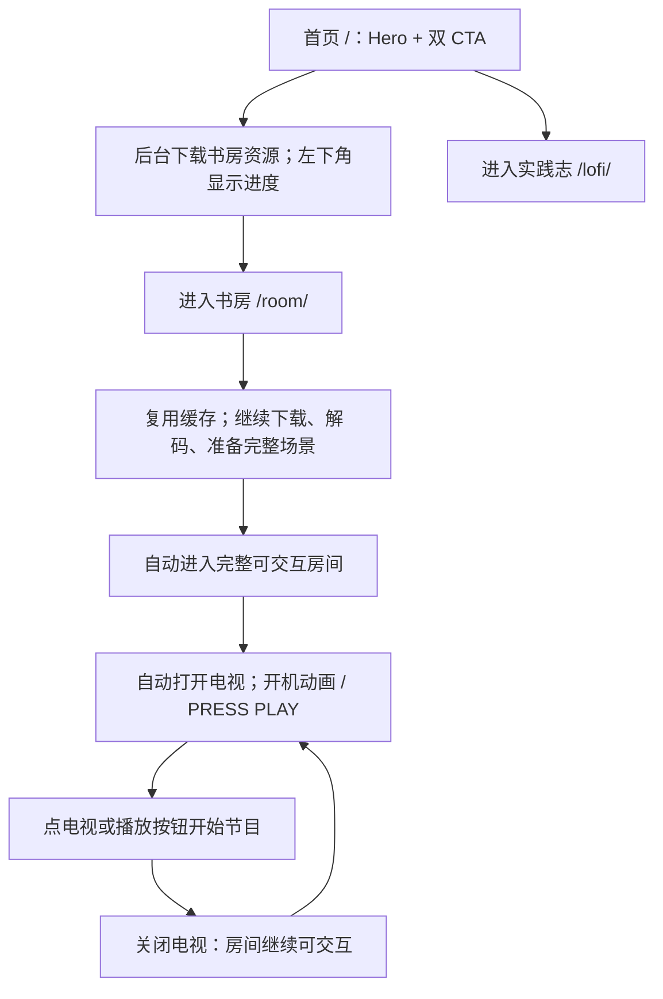

# 首页与书房入口

首页 `/` 保留「写给自己的实践志」Hero 的内容与两个出口。Hero 使用独立的
`HomeHero.astro` 样式作用域，后续首页换皮不依赖博客的视觉系统。
雨滴、折射、雾气恢复和按住拖动擦拭复用原 `RainGlassBackground` 的
`RainGlassController`；离开页面释放资源，浏览器返回缓存页面时重新挂载。
无 WebGL / JavaScript 时保留静态背景和双入口。减少动态效果时保留静态雨滴与擦拭。
`/lofi/` 从现有文章目录开始，分类、阅读、搜索和分页沿用原界面。



首页的预加载百分比衡量资源下载，不代表 GPU 解码和首帧已完成。提前点进书房
仍会显示原有加载进度，并在完整场景准备完成后自动进入。首页与书房共用同一
内容哈希清单和持久资源缓存；缓存受限或被浏览器清理时可以正常重新下载。
视频按范围请求预热，不把整段影片计入静态资源百分比。

电视的开机提示只控制电视内容，不阻止拖动视角、物件交互或页面导航。
声音继续由 SOUND 独立开关控制，首次访问默认关闭。减少动态效果设置会跳过
开机动画，保留播放提示；媒体播放被浏览器限制时保留播放按钮供重试。

`/room/` 可直接访问、刷新，房内 `#work`、`#posts` 等深链继续生效。
页面左上角标识返回首页，阅读链接进入博客。窄窗口和不支持 WebGL 2 的设备
沿用阅读版降级，提供博客出口。无 JavaScript 时首页两个链接仍可使用。

## 验证

常规检查：`npm test`、`npm run check`、`npm run build`、
`npm run verify:build`、`npm run test:browser`。

完整 3D 流程需要支持硬件 WebGL 的浏览器。在生产预览启动后运行：

```sh
BASE_URL=http://127.0.0.1:4327 BROWSER_CHANNEL=chrome npm run test:room-flow
BASE_URL=http://127.0.0.1:4327 BROWSER_CHANNEL=chrome npm run test:rain-glass
```

可将 `SMOKE_SCREENSHOT_DIR` 指向已忽略的 `.room-build/home-room-flow/` 保存证据。
该脚本覆盖首页预加载和缓存复用、提前进入、失败重试、电视反复开关、深链刷新、
返回首页与博客，以及窄屏和 WebGL 不可用的降级。
雨玻璃脚本用真实拖拽和截图像素比较验证擦雾、雨滴动画、返回首页后的恢复与静态降级。

本次不更换首页为卡通岛视觉，不引入 UI 依赖，不修改书房几何或美术资源。
