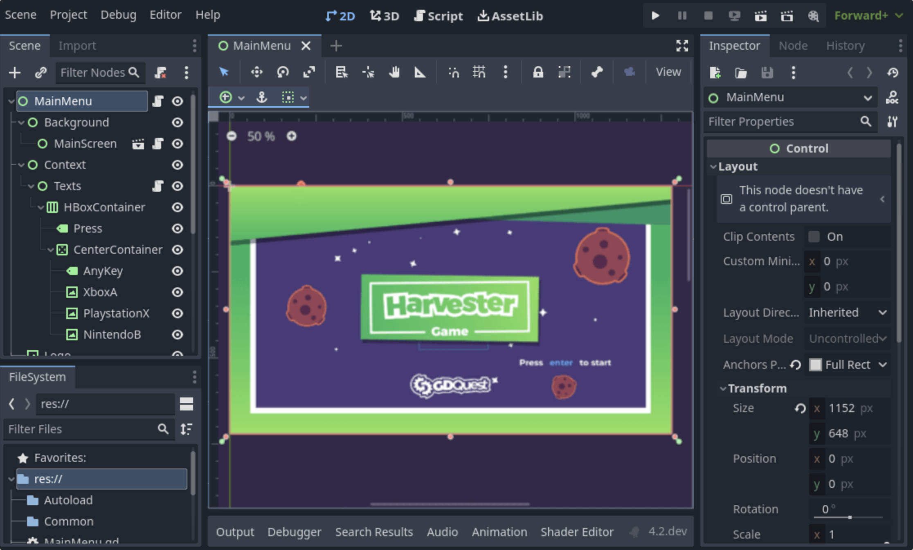
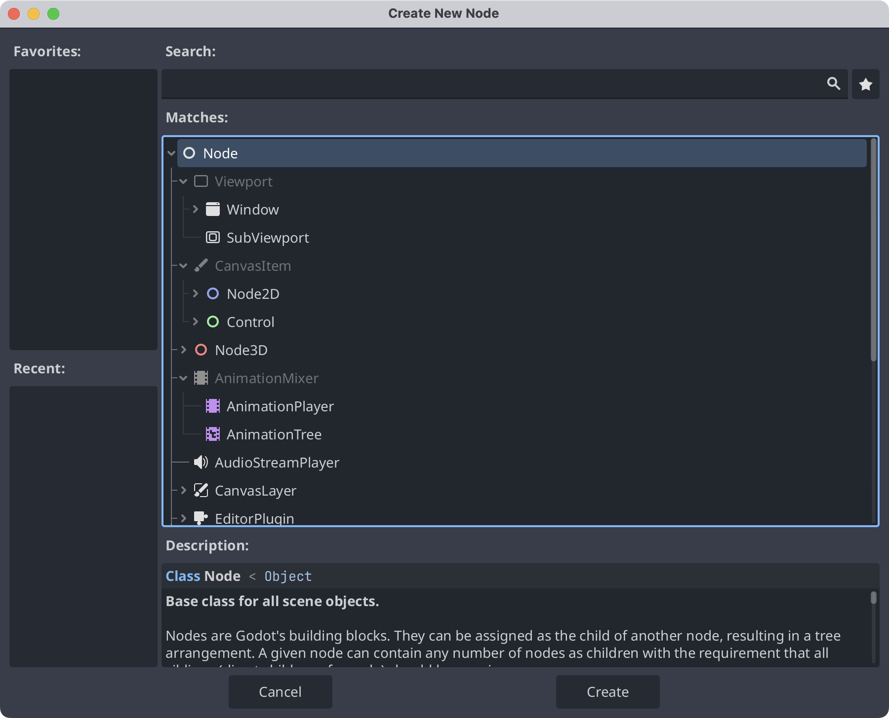
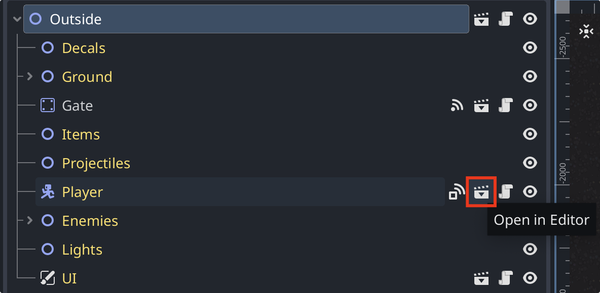

I wrote these notes after completing my second Godot project, which gave me a broad overview of the engine.
[The tutorial I followed](https://www.bilibili.com/video/BV1pu4y1b7p6) covers a lot of ground, so I decided to collect what I had learned in a series of posts.
I will roughly follow the order of the tutorial and the [official documentation](https://docs.godotengine.org/en/stable/) as I revisit the material.

This post introduces scenes, nodes, the scene tree, and signals in Godot 4. The interface examples use English labels.

**Sources:** These notes summarize the tutorial and Godot’s [overview of key concepts](https://docs.godotengine.org/en/stable/getting_started/introduction/key_concepts_overview.html), with my own explanations.

> [!NOTE]
> I expect this series to focus on 2D development. I am still learning, so there may be mistakes, and some details may become outdated as Godot evolves.
> If you spot an error or want to discuss something, leave a comment below.

## Scenes

In Godot, you build a game by creating many scenes. A scene might represent a character, a weapon, a menu, or a complete user interface (UI). The screenshot below shows a main menu scene in the editor.

Scenes are reusable: once you have created one, you can instantiate it wherever you need it. You build your game by combining these scene instances.

## Nodes

Nodes are the smallest building blocks of a scene in Godot. The **Create New Node** dialog lists the available node types and their inheritance hierarchy.

Each node type provides different capabilities. A scene consists of one or more nodes arranged in a tree.

All nodes share these features:

- Editable properties
- Callbacks that let them update every frame
- Support for extension with new properties and methods
- Support for being added as children of other nodes

## The scene tree

Once we have created our scenes, we can combine them to build levels or maps. A level can contain several scene instances, each with its own nodes. At runtime, these nodes become part of the game’s scene tree.

In the screenshot below, **Player** is a scene instance. Its scene icon displays the **Open in Editor** tooltip; click it to open and edit the source scene.

## Signals

Signals let nodes notify other parts of the game when something happens.

Node types provide built-in signals, and we can also define custom ones. I will explore signals in more detail as this series continues.

When an event occurs—for example, a body enters an area, a timer expires, or two bodies collide—the relevant node can emit a signal to invoke connected functions.

Signals can also connect nodes in different scene instances. With references to the relevant objects, you can connect a signal to a receiving method; emitting the signal then invokes that method. See the [official Signal documentation](https://docs.godotengine.org/en/stable/classes/class_signal.html).
