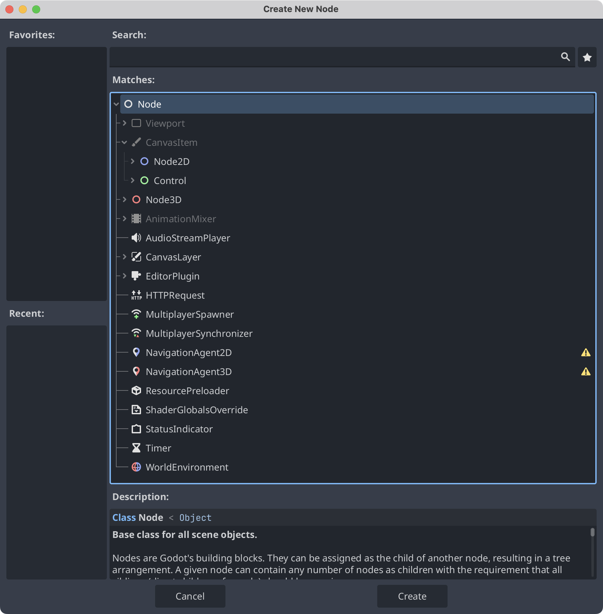

This post introduces common 2D nodes in Godot 4 and their uses. Interface labels follow the English editor.

Nodes are the smallest building blocks of a scene. Each node type has its own properties and capabilities. In the **Create New Node** dialog, `Node` sits at the root of the hierarchy. `CanvasItem`, a subclass of `Node`, is the abstract base class for nodes that draw in 2D. Its subclasses include `Node2D`, the base class for 2D game objects, and `Control`, the base class for user interface (UI) nodes. Most of the nodes covered in this series inherit from `Node2D` or `Control`.

Godot provides built-in lifecycle callbacks whose names begin with `_`, including:

- `_ready()`, which runs when the node is ready in the scene tree.
- `_process()`, which runs once per rendered frame while processing is enabled.

In a node’s script, you can look up another node by its path using either syntax:

- `get_node("NodePath")`
- `$NodePath`

Replace `NodePath` with the actual path relative to the current node, such as `Player/Camera2D`. Both forms return a reference to the target node. Once you have that reference, you can access its properties and call its methods. You can also assign a scene-unique name to a node to make it easier to look up.

Much of working with Godot involves making nodes communicate with one another.

## The `Area2D` node

An area that detects when physics bodies or other areas enter or leave it. You can move it by changing its position.

**Examples:** Detecting when the player enters a house, or defining a laser’s detection area.

## The `StaticBody2D` node

A static body that other bodies can collide with, intended for objects that stay in place.

**Examples:** Stationary walls, beds, and obstacles.

## The `RigidBody2D` node

A body whose movement is controlled by the physics engine, such as a cannonball. You can give it an initial velocity and let the engine handle its motion.

**Example:** A grenade.

`RigidBody2D` has a gravity scale that defaults to `1`. Configure its physics behavior in the **Inspector**, and use a `PhysicsMaterial` to adjust properties such as friction and bounce.

## The `CharacterBody2D` node

A moving body controlled by code, with built-in methods to help manage its movement.

**Examples:** Entities controlled by code, including the player and enemies.
