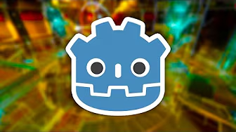
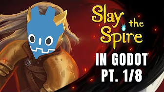
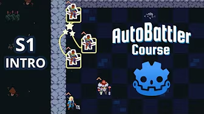
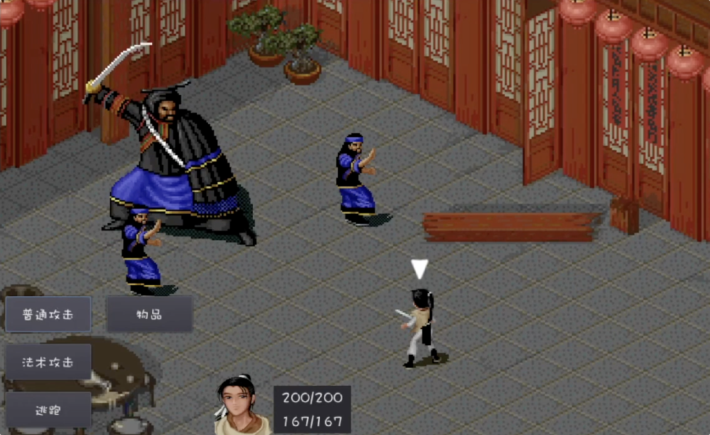
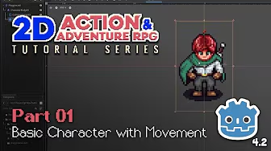

This collection brings together Godot 2D video tutorials, example projects, and a written tutorial. The ratings reflect my personal recommendations; the level beside each title indicates the intended audience. The preview images come from the tutorials linked below them.

## Five-star recommendations

### The Ultimate Introduction to Godot 4 (beginner)

- [Watch on YouTube](https://www.youtube.com/watch?v=nAh_Kx5Zh5Q)
- [Watch on bilibili](https://www.bilibili.com/video/BV1pu4y1b7p6/)
- [Source code on GitHub](https://github.com/clear-code-projects/UltimateGodotIntro2D)

### Intermediate Card Game (intermediate)

- [Watch on YouTube](https://www.youtube.com/playlist?list=PL6SABXRSlpH8CD71L7zye311cp9R4JazJ)
- [Watch on bilibili](https://www.bilibili.com/video/BV1PC411L78f)
- [Source code on GitHub](https://github.com/guladam/deck_builder_tutorial/tree/season-1-starter-project)

### Godot 4 Autobattler (intermediate)

- [Watch on YouTube](https://www.youtube.com/playlist?list=PL6SABXRSlpH_0UEV3gJ53I7a2eGL8pqs3)
- [Watch on bilibili](https://www.bilibili.com/video/BV1oAHke4EYm)
- [Source code on GitHub](https://github.com/guladam/godot_autobattler_course/tree/starter-project)

## Four-star recommendations

### Recreating turn-based combat from The Legend of Sword and Fairy (intermediate)

- [Watch on bilibili](https://space.bilibili.com/12263615/lists/636637?type=series)

### Make a 2D Action & Adventure RPG in Godot 4 (intermediate)

- [Watch on YouTube](https://www.youtube.com/watch?v=QPeycNt29tY)
- [Watch on bilibili](https://www.bilibili.com/video/BV1sB2NYLEwj)
- [Source code on GitHub](https://github.com/michaelmalaska/aarpg-tutorial)
- [Project assets on itch.io](https://michaelgames.itch.io/2d-action-adventure-rpg-assets)

## Written tutorial

- [Let's Learn Godot 4 by Making an RPG (beginner)](https://dev.to/christinec_dev/lets-learn-godot-4-by-making-an-rpg-part-1-project-overview-setup-bgc)
