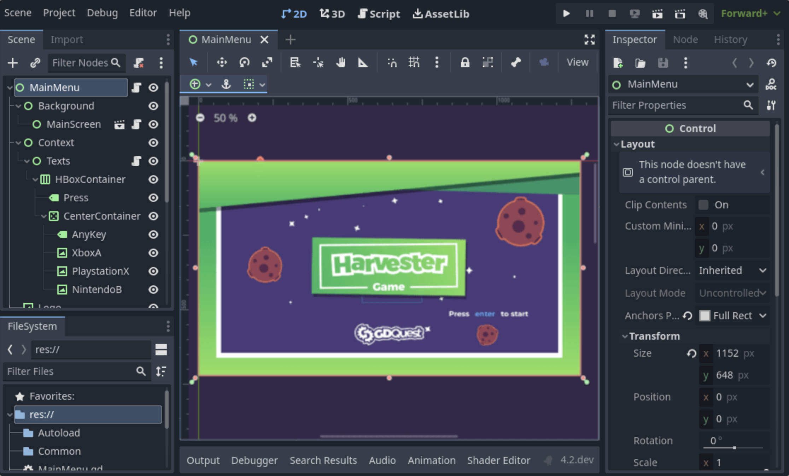
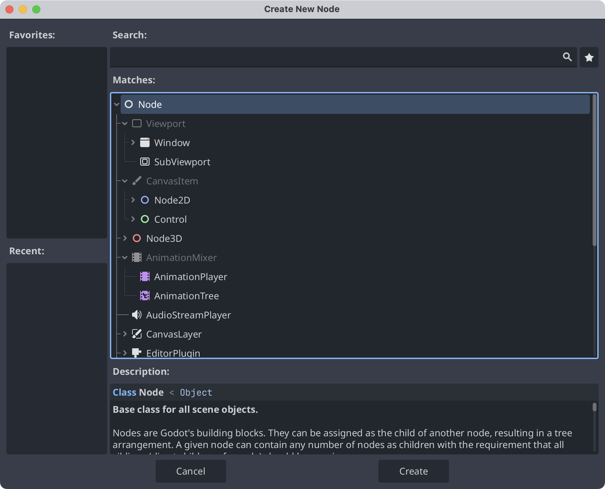
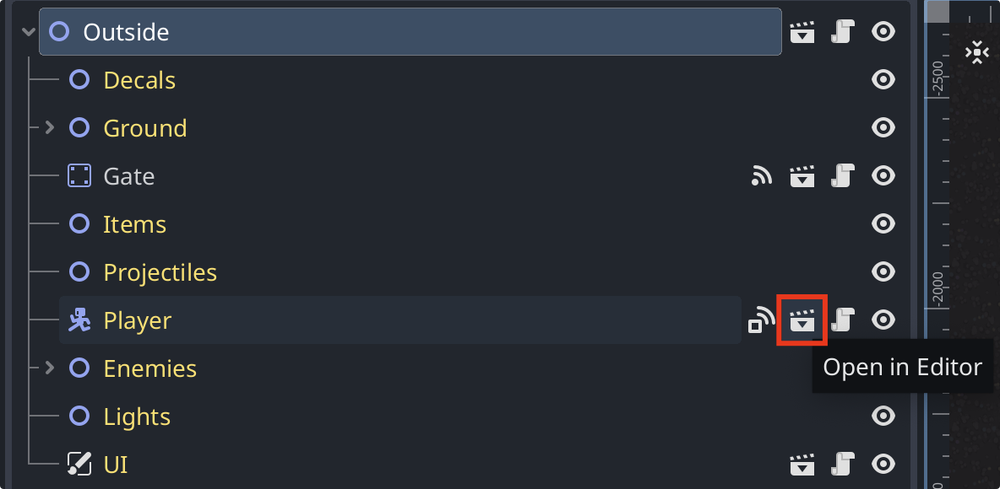

我在完成第二个 Godot 项目后写下这组笔记。这个项目让我对引擎有了整体认识。[我跟着学习的教程](https://www.bilibili.com/video/BV1pu4y1b7p6)覆盖了不少内容，因此我决定用一系列文章整理所学知识，并大致按照教程和[官方文档](https://docs.godotengine.org/en/stable/)的顺序回顾。

本文介绍 Godot 4 的四个核心概念：场景、节点、场景树和信号。界面示例使用英文标签。

**资料来源：** 这组笔记概括了教程和 Godot [核心概念概览](https://docs.godotengine.org/en/stable/getting_started/introduction/key_concepts_overview.html)，并加入了我自己的解释。

> [!NOTE]
> 这个系列主要讨论 2D 开发。我仍在学习，文章可能存在错误，部分细节也可能随 Godot 的更新而过时。如果发现问题，欢迎在评论区指出。

## 场景

在 Godot 中，可以通过组合场景来构建游戏。一个场景可以表示角色、武器、菜单或整套用户界面（user interface，UI）。下图以主菜单为例，展示场景在编辑器中的样子。

场景可以复用：创建场景后，可以在需要的位置实例化它，再组合这些场景实例来构建游戏。

## 节点

节点是构成场景的最小单元。不同类型的节点提供不同的属性和功能。英文界面的 **Create New Node** 对话框展示了可用的节点类型及其继承关系。

一个场景由一个或多个节点组成，这些节点按树状结构排列。所有节点都具备以下能力：

- 提供可编辑的属性。
- 通过回调在每帧更新。
- 扩展新的属性和方法。
- 成为其他节点的子节点。

## 场景树

创建好场景后，可以将它们组合成关卡或地图。一个关卡可以包含多个场景实例，每个实例都有自己的节点；运行时，这些节点会成为游戏场景树的一部分。

下图中的 **Player** 节点来自一个场景实例。它右侧的场景图标显示 **Open in Editor** 提示，点击即可打开并编辑源场景。

## 信号

信号用于在事件发生时通知游戏中的其他对象。节点类型提供内置信号，也可以定义自有信号。后续文章会继续介绍它们的用法。

例如，当物体进入区域、计时器结束或两个物体发生碰撞时，相关节点可以发出信号，调用已连接的函数。

信号也可以连接不同场景实例中的节点。取得相关对象的引用后，可以将信号连接到接收方法；发出信号时，该方法就会被调用。详见 [Signal 官方文档](https://docs.godotengine.org/en/stable/classes/class_signal.html)。
