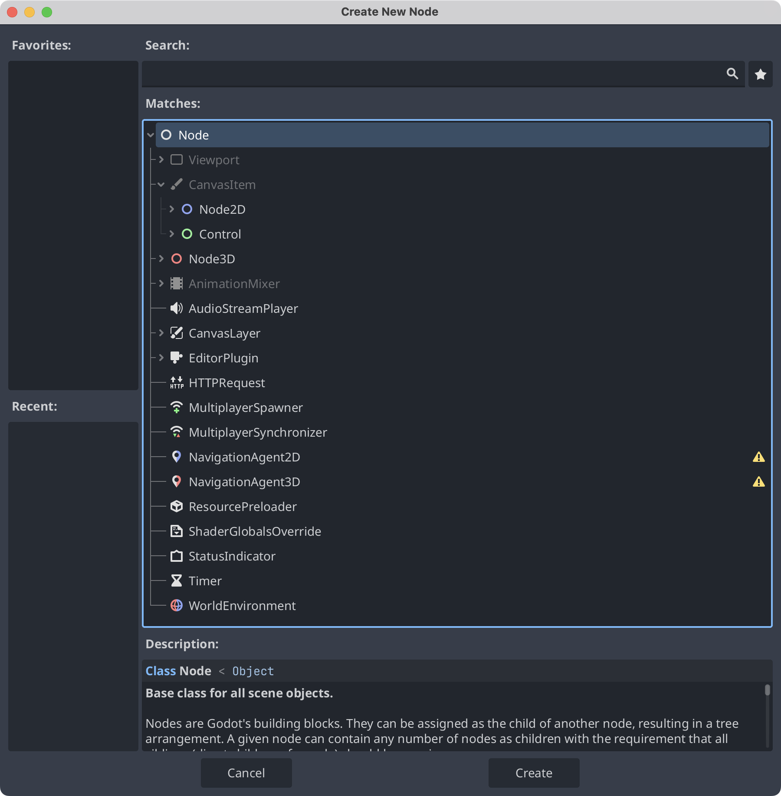

本文介绍 Godot 4 中常见的 2D 节点及其用途，界面标签采用英文名称。

节点是场景的最小构成单元，每种节点都有自己的属性和功能。在 **Create New Node** 对话框中，`Node` 位于类型层级的根部。它的子类 `CanvasItem` 是可在 2D 空间中绘制内容的抽象基类；`Node2D` 是 2D 游戏对象的基类，`Control` 是用户界面（UI）节点的基类，两者都继承自 `CanvasItem`。这个系列涉及的大多数节点都继承自 `Node2D` 或 `Control`。

Godot 提供名称以 `_` 开头的内置生命周期回调，例如：

- `_ready()`：节点在场景树中准备就绪后调用。
- `_process()`：启用处理时，在每个渲染帧调用。

在节点脚本中，可以使用以下任一写法按路径查找其他节点：

- `get_node("NodePath")`
- `$NodePath`

将 `NodePath` 替换为相对于当前节点的实际路径，例如 `Player/Camera2D`。这两种写法都返回对目标节点的引用；取得引用后，就可以访问它的属性并调用方法。也可以为节点设置场景唯一名称，便于通过名称查找。

让节点之间相互通信，是使用 Godot 构建游戏的重要部分。

## `Area2D` 区域节点

`Area2D` 可以检测物理物体或其他区域何时进入、离开其范围。修改位置可以移动这个区域。

**示例：** 检测玩家是否进入房屋，或定义激光的检测范围。

## `StaticBody2D` 静态物体

`StaticBody2D` 可与其他物体发生碰撞，适用于保持在固定位置的对象。

**示例：** 墙壁、床和静止的障碍物。

## `RigidBody2D` 刚体

`RigidBody2D` 的运动由物理引擎控制。可以为它设置初始速度，再由引擎计算后续运动。

**示例：** 炮弹或手榴弹。

`RigidBody2D` 的重力缩放值默认为 `1`。可以在 **Inspector** 中配置其物理行为，并通过 `PhysicsMaterial` 设置摩擦和弹性等属性。

## `CharacterBody2D` 角色物体

`CharacterBody2D` 由代码控制移动，并提供辅助处理移动的方法。

**示例：** 玩家角色、敌人及其他由代码控制的实体。
