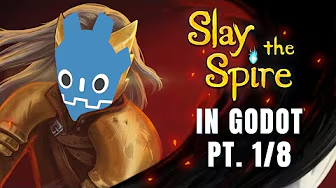
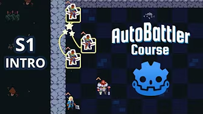
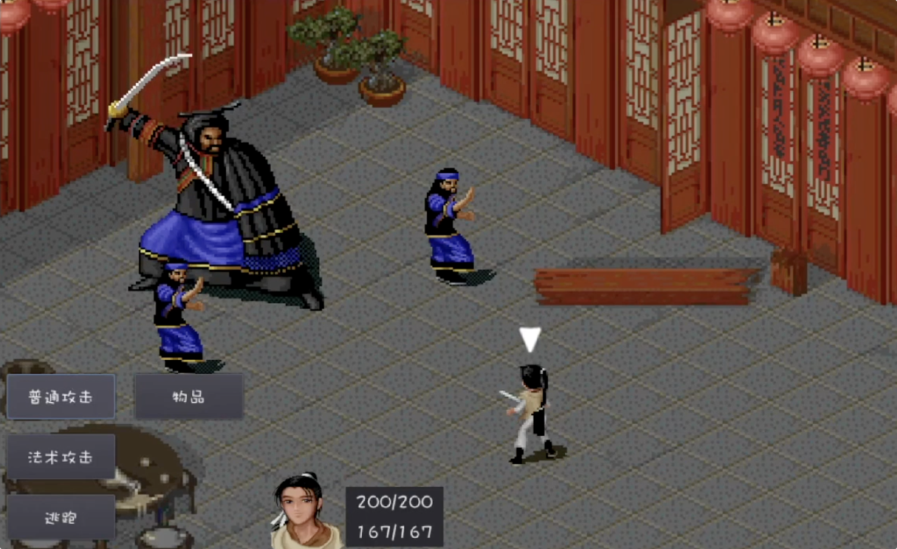
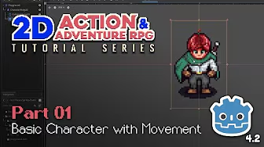

本文收集 Godot 2D 视频教程、示例项目和图文教程。星级代表我的个人推荐程度，标题后的“入门”和“进阶”说明适合的学习阶段。预览图来自各节所链接的教程。

## 五星推荐

### The Ultimate Introduction to Godot 4（入门）

- [在 YouTube 观看](https://www.youtube.com/watch?v=nAh_Kx5Zh5Q)
- [在 bilibili 观看](https://www.bilibili.com/video/BV1pu4y1b7p6/)
- [GitHub 源代码](https://github.com/clear-code-projects/UltimateGodotIntro2D)

### Intermediate Card Game（进阶）

- [在 YouTube 观看](https://www.youtube.com/playlist?list=PL6SABXRSlpH8CD71L7zye311cp9R4JazJ)
- [在 bilibili 观看](https://www.bilibili.com/video/BV1PC411L78f)
- [GitHub 源代码](https://github.com/guladam/deck_builder_tutorial/tree/season-1-starter-project)

### Godot 4 Autobattler（进阶）

- [在 YouTube 观看](https://www.youtube.com/playlist?list=PL6SABXRSlpH_0UEV3gJ53I7a2eGL8pqs3)
- [在 bilibili 观看](https://www.bilibili.com/video/BV1oAHke4EYm)
- [GitHub 源代码](https://github.com/guladam/godot_autobattler_course/tree/starter-project)

## 四星推荐

### 复刻《仙剑奇侠传》回合制战斗（进阶）

- [在 bilibili 观看](https://space.bilibili.com/12263615/lists/636637?type=series)

### Make a 2D Action & Adventure RPG in Godot 4（进阶）

- [在 YouTube 观看](https://www.youtube.com/watch?v=QPeycNt29tY)
- [在 bilibili 观看](https://www.bilibili.com/video/BV1sB2NYLEwj)
- [GitHub 源代码](https://github.com/michaelmalaska/aarpg-tutorial)
- [itch.io 项目素材](https://michaelgames.itch.io/2d-action-adventure-rpg-assets)

## 图文教程

- [Let's Learn Godot 4 by Making an RPG（入门）](https://dev.to/christinec_dev/lets-learn-godot-4-by-making-an-rpg-part-1-project-overview-setup-bgc)
