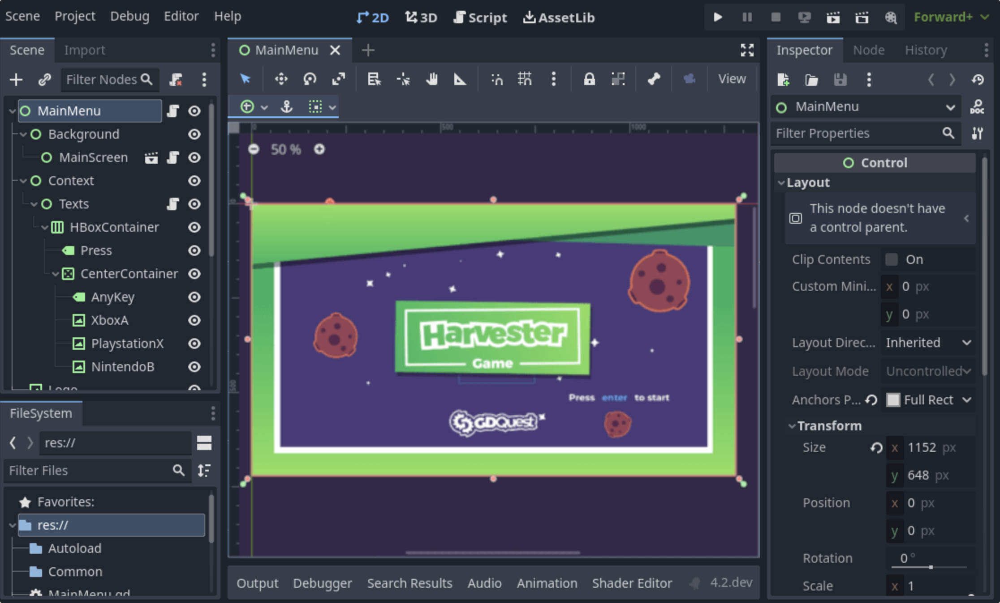
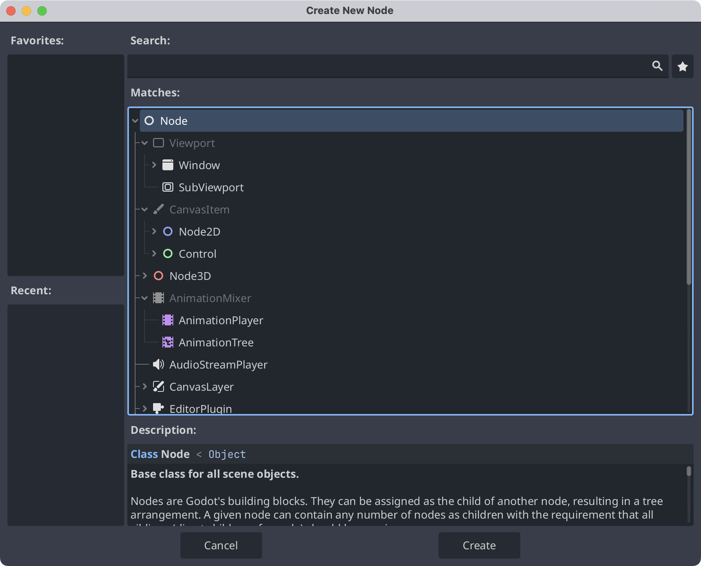
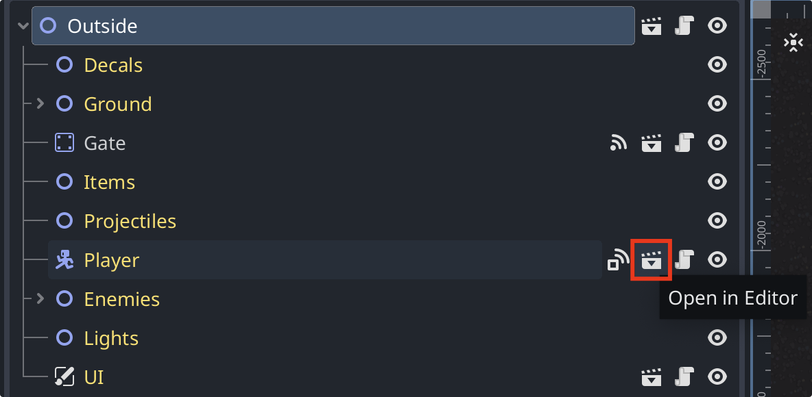

I wrote these notes after finishing a project that gave me a broad overview of Godot. It was also my second Godot project.
[This tutorial](https://www.bilibili.com/video/BV1pu4y1b7p6) covers a lot of ground, and after working through it, I decided to summarize what I had learned in a series of posts.
I will try to follow the order of the tutorial and the [official documentation](https://docs.godotengine.org/en/stable/) as I review the material.

These notes are not presented as entirely original work. They may include substantial translation or quotations, alongside my own understanding.

> [!TIP]
> This series will probably focus entirely on 2D development. The discussion is limited to that area, and some of my understanding may be inaccurate: I am still learning, and Godot continues to evolve, so certain concepts may become outdated.
> Corrections and discussion are welcome. Leave a message in the comments below.

## 1. Scenes

In Godot, you build a game by creating many scenes. A scene might represent a character, a weapon, a menu, or a complete UI.

Scenes are generally reusable. Once you have created a scene, you can use it wherever and whenever you need it. You build your game in Godot by combining these scenes.

## 2. Nodes

Nodes are the smallest building blocks of a scene in Godot.

Different nodes provide different capabilities, and we use them to build scenes. A scene usually contains several nodes; in other words, a scene is a tree of nodes.

All nodes share these features:
1. Editable properties.
2. Callbacks that let them update every frame.
3. The ability to extend them with new properties and methods.
4. The ability to add them as children of other nodes.

## 3. The scene tree

After creating our scenes, we need to assemble the game’s levels or maps. One way to picture this is that a scene is a tree of nodes, while a level is a tree of scenes.

Items with this icon are scenes used in the example level. Click the scene icon to open the original scene and edit it again.

## 4. Signals

Signals are an extremely important concept in Godot. For now, a simple way to understand them is as a means of passing information between scenes.

Nodes have their own signals, and we can also define custom ones. I will expand these notes on signals as this series continues.

When something happens to a node—for example, a body enters an area, a timer expires, or two bodies collide—you can have the affected node emit a signal, which in turn can call a connected function.

You can define custom signals. Signals are not restricted to a single scene: nodes in different scene instances can communicate once their objects are referenced and a connection is established. Emitting a signal invokes its connected callables. See the [official Signal documentation](https://docs.godotengine.org/en/stable/classes/class_signal.html).
