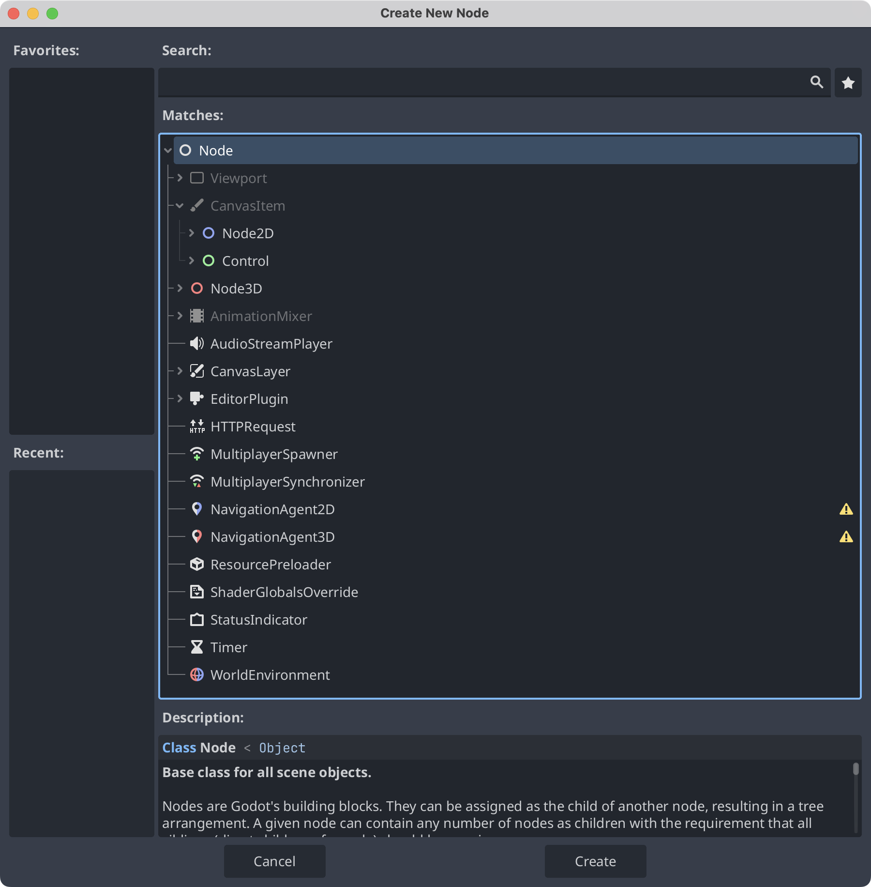

As mentioned in the previous post, nodes are the smallest building blocks of a scene. Different nodes have different properties and provide different capabilities. In <kbd>Create New Node</kbd>, we can see that **Node** sits at the root of the hierarchy. Below it is **CanvasItem**, the abstract base class for objects in 2D space. **Node2D** is the base class for 2D game objects, while **Control** is the base class for UI nodes. Most of the nodes we will study inherit from **Node2D** or **Control**.

> [!TIP]
> Godot provides built-in lifecycle callbacks whose names begin with `_`.
> 1. `_ready()` runs when the node is ready in the scene tree.
> 2. `_process()` runs on every frame of the game.

You can access other nodes in two ways:
1. `get_node("node path")`
2. `$node path`

You can also give nodes a unique name. Once you have a reference to a node in code, you can access its properties and call its methods.

> [!TIP]
> Getting nodes to communicate with each other is a major part of working with Godot.

## 1. Area2D

An area that can detect when another body enters it. Move it by changing its position.

*Examples: detecting when the player enters a house, or defining a laser’s detection area.*

In other words, it defines an area that can detect when another body enters it.

## 2. StaticBody2D

A static body that other bodies can collide with, intended for objects that stay in place.

*Examples: stationary walls, beds, and obstacles.*

## 3. RigidBody2D

A body whose movement is driven by physics, such as a cannonball. Give it an initial velocity.

*Example: a grenade.*

RigidBody2D has a gravity scale that defaults to 1. Configure its physics behavior in the Inspector, with additional properties available through a PhysicsMaterial.

After you set its initial velocity, physics determines how it moves.

## 4. CharacterBody2D

A moving body controlled by code, with built-in methods to help manage its movement.

*Examples: entities controlled by code, including the player and enemies.*
