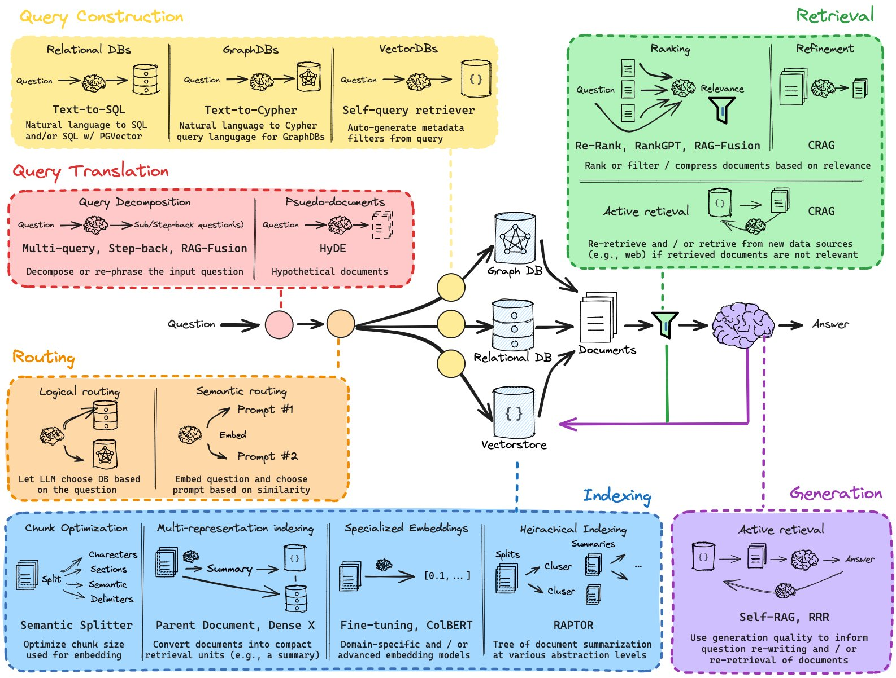

This guide explains how to write and revise articles on this site: how to create a draft and publish it, how to choose formatting by meaning, and which Markdown features the site actually supports. The goal is to help readers find information, understand explanations, and reproduce examples accurately.

To follow the local preview steps, use a checkout of this repository with dependencies installed and Node.js 22.23.4 or later. Run commands from the project root.

## From draft to publication

### Start with a Markdown file

Create `my-note.md` in `posts/en/` and set `key: my-note`; its English URL will be `/en/posts/my-note/`. Put its Chinese counterpart in `posts/zh/` and give both files the same `key`. The article language is inferred from its directory, so no `locale` field is needed.

```yaml
---
title: My new note
description: Introduce the article in one sentence.
key: my-note
date: 2026-11-04
category: writing
tags: [markdown]
draft: true
---
```

`title`, `date`, `category`, and `key` are required. Categories use lowercase letters, digits, and hyphens, such as `travel-notes`; tags may contain Chinese text. Once the article is published, new categories and tags appear in their indexes automatically, without manual registration.

`draft: true` marks a draft. A draft may have only one language version. To preview and publish:

1. Run `npm run dev` from the project root.
2. Open **Drafts** in the English navigation and select the article to check its rendering.
3. Prepare both Chinese and English versions with the same `key`. Remove `draft: true` or change it to `false` in both files.
4. Push or merge the files into `main` when you are ready to publish them. This triggers the site’s deployment workflow.

Dates control display and sorting; they do not schedule publication.

#### Field reference

**Resulting metadata**

| Field | Required | Purpose |
| --- | --- | --- |
| `title` | Yes | Page title and article-list title |
| `date` | Yes | Publication date and article ordering |
| `category` | Yes | Category index; use lowercase English letters, digits, and hyphens |
| `key` | Yes | Stable, case-sensitive identifier shared by the Chinese and English versions |
| `description` | No | Summary and page description |
| `tags` | No | Tag index; empty if omitted |
| `subcategory` | No | Subcategory identifier, using the same format as categories |
| `updatedDate` | No | Date of the latest update |
| `pin` | No | Pinned status; defaults to `false` |
| `draft` | No | Draft status; defaults to `false` |

A production build does not emit draft articles or indexes. A published article must have a published counterpart in the other language. After you add or remove an article, the next build updates article lists, categories, tags, archives, RSS, the sitemap, and the search index.

You do not need to maintain index configuration by hand. `name`, `desc`, and `latex` are not publishing fields on this site. Use ordinary images for flowcharts; this site does not render Mermaid.

### Where an article appears after publication

When you publish a post, the next build adds it to the blog’s home page, category and tag pages, archives, RSS feed, and full-text search index. The table of contents is generated automatically from level-two and level-three headings.

Use standard Markdown syntax for links, too. When linking to another page, use its published URL (for example [About](/en/about/)) rather than the path to a `.md` source file.
## Writing conventions

This guide is for writing and revising articles on this site. Its goal is to help readers find information, understand an explanation, and reproduce examples accurately. Formatting serves the content: first decide what a passage is doing, then choose a heading, list, code block, or note.

### Scope and reference sources

The organization and wording of technical documentation primarily follow the [Google developer documentation style guide](https://developers.google.com/style), with the [Microsoft Writing Style Guide](https://learn.microsoft.com/en-us/style-guide/welcome/) as a supplementary reference. Chinese wording and typography draw on [Ruan Yifeng’s Chinese technical documentation style guide](https://github.com/ruanyf/document-style-guide) and the [Chinese Copywriting Guidelines](https://github.com/sparanoid/chinese-copywriting-guidelines). These are public writing guides, not a single mandatory standard for every kind of prose.

Where their recommendations differ, use these priorities:

1. Preserve the accuracy of code, commands, product names, interface labels, and direct quotations. Do not change their contents to satisfy a typographic preference.
2. Use Google’s recommendations for the structure and meaning of technical information. Consult Microsoft for matters Google does not cover, including certain procedural instructions.
3. Follow the Chinese guides for Chinese punctuation, mixed-language text, and wording. This site adopts the Chinese Copywriting Guidelines’ spaces between Chinese text and digits, and Ruan Yifeng’s outer double quotation marks “ ” and inner single quotation marks ‘ ’.
4. Apply the English guides’ American punctuation, heading capitalization, and use of italics only in the corresponding English context. Chinese headings, book titles, and dates follow Chinese conventions.

These choices keep articles consistent; they do not make other valid styles grammatical errors. Personal notes can retain an individual voice, while tutorials should prioritize complete steps and verifiable results.

### Document structure

#### Titles and heading levels

A title should identify the problem an article solves or the concept it discusses, such as “Add a pause menu to a Godot scene” or “Resource loading and instance creation.” Avoid titles such as “A quick note” or “Some issues” that do not make sense on their own.

An article has one main title. This site generates it from the frontmatter `title`; start the body with `##`, use `###` for subsections, and do not skip levels. Do not disguise bold paragraphs as headings or choose a deeper heading level merely to get smaller text.

Use similar phrasing for headings at the same level. A tutorial might use “Create the scene,” “Connect the signal,” and “Verify the result”; a conceptual article might use “Input conditions,” “State transitions,” and “Edge cases.” A short passage does not need further subdivision. Add levels when longer material needs them.

References: [Google’s heading guidance](https://developers.google.com/style/headings), [Chinese title conventions](https://github.com/ruanyf/document-style-guide/blob/master/docs/title.md).

#### Paragraphs and reading order

Begin with the topic, scope, and what the reader will learn. Develop one central point per paragraph: give the conclusion or key fact first, followed by reasons, examples, and limitations. Use clear subheadings when comparing different situations.

Leave a blank line between Markdown paragraphs, and do not begin paragraphs with full-width spaces. Do not simulate indentation or layout with repeated spaces, manual line breaks, or `<br>`. Judge paragraph length by how easily a reader can follow it, not by the number of lines it happens to occupy on one screen.

Reference: [Chinese paragraph conventions](https://github.com/ruanyf/document-style-guide/blob/master/docs/paragraph.md).

### Explanations and procedures

#### Facts, explanations, and judgments

Make clear who performs an action and what happens as a result. Write “The application calls `onTimeout()` after the request times out” instead of an ambiguous “It is called after a timeout.” When an action depends on a condition, state the condition first: “If you need to preserve the original resource, create a copy first.”

Use familiar words and split sentences that contain too many conditions. Distinguish measured results, documented behavior, and personal conjecture. State the test conditions for performance claims, and do not turn a single observation into a claim about every environment. Words such as “obviously” or “very simple” do not replace an explanation.

Reference: [Google’s writing highlights](https://developers.google.com/style/highlights).

#### Tutorials and verification

Use numbered steps for operations that must happen in order. Before the steps, state the required software versions, files, permissions, and starting conditions. Begin each step with an action; where necessary, first identify where to perform it, then describe the expected result.

For example, an editor procedure could read:

1. Select the target node in the scene tree.
2. In the Inspector, find **Process** and set **Mode** to **Always**.
3. Run the scene, pause it, and verify that the node still processes input.

Label optional steps as optional. If there are many branches, split them into separate sections rather than interleaving instructions for different platforms. When reproducing an error, give the trigger, actual result, and expected result. A fix should include a way to verify it.

References: [Google’s procedures guidance](https://developers.google.com/style/procedures), [Microsoft’s step-by-step instructions](https://learn.microsoft.com/en-us/style-guide/procedures-instructions/writing-step-by-step-instructions).

### Terminology and text semantics

#### Names, terms, and abbreviations

Preserve official product capitalization, such as Godot, GitHub, and TypeScript. In Chinese prose, prefer clear, established Chinese translations for ordinary technical concepts. Do not switch between translations within one article without explanation.

Explain unfamiliar terms when they first appear. If an abbreviation will recur, introduce its full form first—for example, “abstract syntax tree (AST)”—and use AST afterward. A term that appears only once usually does not need a new abbreviation. Whether to expand API, HTML, and similar terms depends on the intended reader.

References: [Google’s abbreviations guidance](https://developers.google.com/style/abbreviations), [Chinese Copywriting Guidelines: names](https://github.com/sparanoid/chinese-copywriting-guidelines/blob/master/README.zh-Hans.md#名词).

#### Choose meaningful formatting

Choose markup according to the purpose of the text, rather than inventing separate meanings for font sizes or colors.

| Meaning | Format | Example |
| --- | --- | --- |
| A name or literal value in code | Inline code | The `TreeNode` class, `_ready()` method, `timeout` parameter, or `false` value |
| A file, path, command, or option | Inline code | `project.godot`, `src/main.ts`, `npm run dev`, `--port` |
| A visible interface label | Bold; preserve the interface wording | Choose **File**, then **Save** |
| A short label within a paragraph | Brief bold text | **Prerequisite:** A scene has been created |
| Emphasis in prose | Prefer clear wording; use emphasis sparingly | Create the resource *only on the first load* |
| A keyboard key | Key name or `<kbd>` | <kbd>Ctrl</kbd> + <kbd>S</kbd> |
| Someone else’s words | Quotation marks or a blockquote, with a source | Keep them distinct from the author’s explanation |
| Supporting explanation or a source | Ordinary prose or a footnote | Put background that does not interrupt the main argument in a footnote |

Class names and keywords are code identifiers, so use inline code. Ordinary product names use normal prose formatting. Communicate importance through words; color may help distinguish content. `<sub>` and `<sup>` represent subscripts and superscripts, useful for chemical formulas, powers, and similar notation.

References: [Google’s text formatting](https://developers.google.com/style/text-formatting), [code in text](https://developers.google.com/style/code-in-text), [mathematical notation](https://developers.google.com/style/mathematical-notation).

#### Interfaces, keyboard input, and notices

Write interface labels exactly as they appear in the version being described. Identify the language and platform when needed, rather than making readers guess which English option a Chinese label refers to. Write longer menu paths as complete instructions instead of relying only on arrows to show the sequence.

In a keyboard shortcut, `+` means pressing keys together. Describe sequential input as “Press …, then press ….” List macOS and Windows keys separately when they differ; `Ctrl` and `Command` are not interchangeable names. Keycap markup displays a key but does not register a shortcut on the page.

Use notice blocks for short supplementary information or risk information that needs emphasis. Keep prerequisites and essential steps in the main text; do not turn an entire article into a sequence of notices. Use the notice types documented below under “GitHub-style alerts,” rather than assuming another platform’s type names work here.

References: [Microsoft’s keyboard shortcuts guidance](https://learn.microsoft.com/en-us/style-guide/a-z-word-list-term-collections/term-collections/keys-keyboard-shortcuts), [Google’s notices guidance](https://developers.google.com/style/notices).

### Code and command examples

Before a code example, explain its purpose, where it runs, and any prerequisites. Afterward, explain key lines or expected output. Use a fenced code block with a language name, and keep the text copyable. Follow the indentation conventions of the language and project; do not force every language into one indentation style merely for visual consistency.

For example, start the development server from the project directory:

```sh
npm run dev
```

Separate input commands from example output. Do not mix terminal prompts such as `$` or `>` or output text into commands intended for direct copying. An example labeled runnable should contain everything needed to run it. For a snippet, explain what has been omitted and mark omissions with comments in that language.

Use meaningful placeholders for values readers must replace, and explain them nearby:

```sh
git clone REPOSITORY_URL
```

Replace `REPOSITORY_URL` with the target repository URL. Do not rely on color to distinguish a placeholder from a real value, and avoid unexplained placeholders such as `xxx`. Preserve the command’s actual quotation marks, capitalization, and spaces; do not replace them with Chinese punctuation.

Use a code tab group when showing implementations of the same task in different languages. Each tab should describe the same behavior and share the same prerequisites. Do not hide two consecutive steps behind mutually exclusive tabs. If a command overwrites or deletes something, explain what it affects and how it can be recovered before showing the command.

References: [Google’s code examples](https://developers.google.com/style/code-samples), [placeholders](https://developers.google.com/style/placeholders).

### Chinese typography

#### Spacing in mixed-language text

Leave one ordinary space between Chinese text and English words or Arabic numerals, and between numbers and most unit symbols. Do not add spaces around full-width punctuation. Preserve official product names, direct quotations, and strings inside code.

| Situation | Example in Chinese |
| --- | --- |
| Chinese and English | 使用 Godot 创建场景。 |
| Chinese and digits | 共有 3 个节点。 |
| Numbers and units | 延迟为 20 ms，内存为 512 MB。 |
| Percentages and angles | 成功率为 98%，旋转角度为 45°。 |
| Full-width punctuation | 选择 Node，然后运行。 |

Ruan Yifeng’s guide permits either spaced or unspaced Chinese-digit combinations if the choice is consistent. This site follows the spaced style in the Chinese Copywriting Guidelines. Do not insert spaces around Chinese links mechanically for visual separation; decide according to the language of the link text and its surrounding text.

References: [Chinese text conventions: spacing](https://github.com/ruanyf/document-style-guide/blob/master/docs/text.md), [Chinese Copywriting Guidelines: spaces](https://github.com/sparanoid/chinese-copywriting-guidelines/blob/master/README.zh-Hans.md#空格).

#### Punctuation, quotations, and titles

Use Chinese punctuation, such as `，。；：？！`, in Chinese sentences, and English punctuation in complete English sentences. Use the Chinese enumeration comma between parallel names in a Chinese sentence, as in “GDScript、C# 和 Python.” Preserve punctuation inside code, URLs, and filenames.

In Chinese text, use “ ” for quotations and ‘ ’ for quotations inside quotations; use （ ） for parenthetical information. Use 《 》 for Chinese book and article titles. English work titles may use italics or a clearly named link. Use “……” for an ellipsis, not “。。。”; do not pile up question marks or exclamation marks in ordinary explanations.

Headings usually do not end with periods. Divide prose into proper sentences rather than joining many layers of meaning with commas. The page handles line-breaking typography; do not patch it with spaces or manual line breaks in Markdown.

References: [Chinese punctuation conventions](https://github.com/ruanyf/document-style-guide/blob/master/docs/marks.md), [Chinese Copywriting Guidelines: full-width and half-width characters](https://github.com/sparanoid/chinese-copywriting-guidelines/blob/master/README.zh-Hans.md#全角和半角).

### Numbers, units, and time

Use ordinary digits for technical values and state their units, precision, and measurement basis. Do not represent an unknown value as `0`, and distinguish an “increase of 10%” from an “increase of 10 percentage points.” Keep enough precision to support the conclusion.

| Content | Examples and conventions |
| --- | --- |
| Ordinary counts | `12,500` requests; do not add thousands separators to identifiers, years, or port numbers |
| Ranges | `10 ms to 30 ms`, with units at both ends; state whether endpoints are included when relevant |
| Capacity | Distinguish `MB` from `MiB` and use the units actually used by the system under discussion |
| Temperature and angles | `25 °C` for temperature, `45°` for an angle; their spacing differs |
| Currency | `100 US dollars` or `100 Singapore dollars`; avoid ambiguous currency symbols |
| Dates | `November 4, 2026`; use `2026-11-04` for a numeric date |
| Times | `14:30`; add a time zone for events spanning regions, such as “Singapore time (UTC+08:00)” |

A number and its unit should stay together when displayed; use `20&nbsp;ms` when necessary. Preserve version numbers such as `1.2.0`; they are not decimals, so do not drop the final `0`. Keep timestamps in logs and code in their original format, and explain conversions when comparing across time zones.

References: [Chinese number conventions](https://github.com/ruanyf/document-style-guide/blob/master/docs/number.md), [Google’s units of measure](https://developers.google.com/style/units-of-measure), [dates and times](https://developers.google.com/style/dates-times). The Chinese version of this guide uses the 24-hour clock rather than copying AM/PM conventions from English guides.

### Lists, tables, and images

#### Lists and tables

Use numbered lists for ordered steps or stages, and bullet lists for unordered parallel items. Keep the grammatical structure of items similar. End complete sentences with periods; phrase lists may omit periods, but stay consistent within each list.

Tables work well for comparing several properties of similar objects, such as a parameter’s name, type, default value, and purpose. Give columns clear names and units. Explain whether an empty value means “not applicable,” “not provided,” or “not measured.” Put long paragraphs, procedures, and multiline code in the body instead of squeezing them into tables. Split complex comparisons into smaller tables when that makes mobile reading easier.

References: [Google’s lists guidance](https://developers.google.com/style/lists), [tables](https://developers.google.com/style/tables).

#### Diagrams, screenshots, and alternative text

Use images to show structures, processes, or interfaces that are difficult to explain in words. Keep code, error messages, and terminal output as text whenever possible. Flowcharts can be inserted as ordinary images.

Give informative images alternative text that describes their main message, rather than simply “image” or the filename. Explain the key relationships and conclusions of complex diagrams in the body so readers do not have to see the image to understand the article. Use empty alternative text for purely decorative images.

Crop screenshots to the area being discussed, label units and legends in charts, and credit the author or source of external images. Do not distinguish states through red and green alone; add text or symbols. Explain how an illustration relates to the text before it appears, with a caption below when helpful.

Reference: [Google’s image guidance](https://developers.google.com/style/images).

### Links, quotations, and notes

Link text should describe its destination, such as “See the resource-loading documentation,” rather than only “here.” Link to the specific page or section supporting the point, and prefer original documentation, standards, papers, or project sources. Use stable URLs for links within this site, and link sections to headings that actually exist.

Mark the boundaries of direct quotations and provide the author and source. Do not present your own summary as someone’s exact words. Place sources near the data, conclusions, or external images they support. For extended republication or translation, identify the original author, original URL, and relevant license.

Use footnotes for supporting explanations or sources that would interrupt the main thread. Keep information essential to completing a procedure in the body. Give each footnote a recognizable identifier instead of depending on manually assigned numbers; the page generates the visible numbers. Define symbols close to where they first become necessary for understanding an equation.

To refer back to a defined term, passage, or equation, use numbered references in the body. The target stays in its original location, and later links such as `(1)` or `(2)` take readers back to it. See “Numbered passages and cross-references” below for the syntax.

Blockquotes represent quoted material; notices carry the author’s supplementary guidance. Choose according to the purpose of the content.

References: [Google’s link guidance](https://developers.google.com/style/cross-references), [Chinese paragraph conventions: quotations](https://github.com/ruanyf/document-style-guide/blob/master/docs/paragraph.md).

### Mathematical expressions

Short formulas can appear within a sentence, such as $v = d/t$; put an equation on its own line when it needs separate discussion. Define symbols near their first use, and keep each symbol’s meaning consistent within the same context.

For example, average speed can be expressed as:

$$
v = \frac{d}{t}
$$

Here, $d$ is distance, $t$ is elapsed time, and $t > 0$. If $d$ is measured in meters and $t$ in seconds, the unit of $v$ is meters per second. Conditions and units are part of the explanation and should accompany the equation.

Let mathematical typesetting handle variables, operators, subscripts, and superscripts; do not align them with manual spaces. In code, `x * y` is a program expression; mathematical multiplication in prose may be written as $x \times y$. Choose according to the context. Break complex derivations into steps and explain what the result means.

Reference: [Google’s mathematical notation guidance](https://developers.google.com/style/mathematical-notation). For this site’s math input syntax, see “Math and numbered equation references” below.

### Applicable versions and revisions

At the beginning of a tutorial, state the software versions, platforms, and test conditions that affect the result. Date information that changes over time; avoid phrases such as “the latest version” or “currently supported everywhere” without a time reference.

When an article changes a conclusion or an important step, update its scope and briefly explain meaningful corrections. Use the article’s `updatedDate` for substantive revisions. Spelling and punctuation fixes do not need a lengthy update log. If retaining older instructions, label the version they apply to so old and new steps do not become mixed together.

Before publishing, check that readers can complete the task by following the body: does the title match the content, are terms consistent, are commands complete, do links and footnotes work, and do images and equations have the explanations they need? See “Syntax and examples” below for syntax details, and “From draft to publication” above for publishing fields.
## Syntax and examples

This site shows the syntax it actually supports, organized by layer. You can copy each **Syntax** example directly; its **Result** is generated by the same Markdown renderer used for articles. Publishing fields are covered above under “From draft to publication.”

| Layer | Covered on this page | When moving to another platform |
| --- | --- | --- |
| CommonMark basics | Headings, emphasis, lists, quotations, thematic breaks, links, images, and code | Broadly portable |
| Formal GFM extensions | Tables, task lists, strikethrough, and bare links | Requires GFM support |
| Embedded HTML | Keycaps, collapsible content, subscripts, and superscripts | Depends on which HTML elements the platform permits |
| Site plugins and rendering enhancements | Footnotes, numbered references, alerts, math, code tabs, and heading anchors | Requires corresponding plugins or platform features |

GFM extends CommonMark. A feature appearing on GitHub does not necessarily mean it is part of the formal GFM specification. This site enables GFM and the additional features listed below. See the [CommonMark specification](https://spec.commonmark.org/) and [GFM specification](https://github.github.com/gfm/).

### CommonMark basics

#### Headings and paragraphs

The number of `#` characters determines a heading’s level, and blank lines separate paragraphs. Article titles on this site come from the frontmatter `title`, so the body usually starts with `##`. The example below uses a level-four heading to avoid disrupting this page’s table of contents.

**Syntax**

```markdown
#### A small experiment

First, explain the purpose of the experiment.

Then describe the input conditions and expected result.
```

**Result**

##### A small experiment

First, explain the purpose of the experiment.

Then describe the input conditions and expected result.

#### Emphasis, inline code, and escaping

`**...**` marks strong emphasis, `*...*` marks emphasis, and backticks mark code identifiers. To display a syntax character literally, precede it with a backslash. For guidance on choosing the right meaning, see “Writing conventions” above.

**Syntax**

```markdown
Choose **Save**, then call `save()`.

This is *emphasis*. Write a literal asterisk as \*.
```

**Result**

Choose **Save**, then call `save()`.

This is *emphasis*. Write a literal asterisk as \*.

#### Lists and quotations

Use ordered lists for steps and unordered lists for parallel items. Begin a blockquote with `>`; quoted material still needs attribution.

**Syntax**

```markdown
1. Prepare the input.
2. Run the experiment.

- Record your observations.
- Keep examples of failures.

> This quotation demonstrates the formatting of a blockquote.
```

**Result**

1. Prepare the input.
2. Run the experiment.

- Record your observations.
- Keep examples of failures.

> This quotation demonstrates the formatting of a blockquote.

#### Thematic breaks

Write three or more hyphens, `---`, on their own line to separate topics or sections. Leave blank lines around the break; immediately below text, the hyphens may instead be interpreted as a level-two heading underline. Three consecutive asterisks, `***`, or underscores, `___`, also create a thematic break.

**Syntax**

```markdown
First, record the experimental results.

---

Then discuss where those results apply.
```

**Result**

First, record the experimental results.

---

Then discuss where those results apply.

#### Links and images

Write links as `[text](URL)` and images as ``. Alternative text describes the information conveyed by the image. Flowcharts can also be inserted as ordinary images.

**Syntax**

```markdown
[Back to About](/en/about/)


```

**Result**

[Back to About](/en/about/)

Image syntax is part of basic Markdown. This site additionally provides captions and a zoomed view for standalone images. See “Use images to explain a process” below for a flowchart example.

#### Fenced code blocks

Wrap code in three backticks and specify the language after the opening fence. If an example itself contains triple backticks, use four backticks for the outer fence. Fenced code blocks are basic syntax; highlighting, line numbers, and copy buttons are site enhancements. The copy icon in the upper-right corner preserves indentation and line breaks without copying line numbers.

**Syntax**

````markdown
```python
def double(value):
    return value * 2
```
````

**Result**

```python
def double(value):
    return value * 2
```

### Formal GFM extensions

The following four features appear in the [formal GFM specification](https://github.github.com/gfm/). They require no extra markup or component imports in the article body.

#### Tables and column alignment

The first row contains headers, and the second uses hyphens as separators. Colons control alignment. Escape a pipe inside a cell as `\|`.

Tables automatically use the site’s theme, with no extra markup. Wide tables scroll horizontally within their own region. With a keyboard, press Tab to focus the table region, then use the left and right arrow keys to see the remaining columns.

**Syntax**

```markdown
| Approach | Status | Time (ms) |
| :--- | :---: | ---: |
| Sequential read | Complete | 24 |
| Cached read | Complete | 8 |
| `A\|B` | Pending verification | Not measured |
```

**Result**

| Approach | Status | Time (ms) |
| :--- | :---: | ---: |
| Sequential read | Complete | 24 |
| Cached read | Complete | 8 |
| `A\|B` | Pending verification | Not measured |

#### Task lists

`- [ ]` marks an incomplete item, and `- [x]` marks a completed one. Checkboxes on this site are for display; their state comes from the Markdown source.

**Syntax**

```markdown
- [x] Create a minimal example.
- [ ] Add edge cases.
```

**Result**

- [x] Create a minimal example.
- [ ] Add edge cases.

#### Strikethrough

Use double tildes to mark obsolete content or retain a visible record of a change.

**Syntax**

```markdown
~~Old approach: recalculate every time.~~ New approach: reuse verified results.
```

**Result**

~~Old approach: recalculate every time.~~ New approach: reuse verified results.

#### Automatic bare links

GFM can turn plain URLs and email addresses into links. In prose, descriptive link text is usually preferable.

**Syntax**

```markdown
Project URL: https://example.com

Example email: writer@example.com
```

**Result**

Project URL: https://example.com

Example email: writer@example.com

### Embedded HTML

Markdown can contain HTML. The elements below use standard HTML semantics, rather than a Markdown dialect invented by this site. Other platforms may restrict which elements are allowed.

#### Keycaps

`<kbd>` represents a key a user presses. This site styles it as a keycap. Adding it to an article does not register a keyboard shortcut.

**Syntax**

```html
Save: <kbd>Ctrl</kbd> + <kbd>S</kbd>;
macOS: <kbd>⌘</kbd> + <kbd>S</kbd>.
```

**Result**

Save: <kbd>Ctrl</kbd> + <kbd>S</kbd>; macOS: <kbd>⌘</kbd> + <kbd>S</kbd>.

#### Collapsible content

Wrap the content in `<details>` and put its label in `<summary>`. Leave blank lines between the HTML tags and the Markdown inside them. Expanding and collapsing does not require JavaScript.

**Syntax**

```markdown
<details>
<summary>View the derivation</summary>

First confirm the **input conditions**, then derive the result.

- List the known quantities.
- Check the boundary conditions.

</details>
```

**Result**

<details>
<summary>View the derivation</summary>

First confirm the **input conditions**, then derive the result.

- List the known quantities.
- Check the boundary conditions.

</details>

#### Subscripts and superscripts

`<sub>` represents a subscript, often used in chemical formulas. `<sup>` represents a superscript, useful for powers or ordinal markers.

**Syntax**

```html
The chemical formula for water is H<sub>2</sub>O; a square can be written as x<sup>2</sup>.
```

**Result**

The chemical formula for water is H<sub>2</sub>O; a square can be written as x<sup>2</sup>.

### Site plugins and rendering enhancements

These features make up the site’s extended dialect. Some also appear on platforms such as GitHub, but they are outside the formal GFM extension list above. Check support before copying them into another Markdown environment.

#### Footnotes and return links

This site supports footnotes through its existing `remark-gfm` implementation. That plugin supports them, although the formal GFM specification does not define footnote syntax. Write `[^identifier]` in the body and add a definition with the same identifier. Definitions are collected at the end of the page. Click a number to visit its note, then the return arrow to go back. See the [plugin documentation](https://github.com/remarkjs/remark-gfm).

**Syntax**

```markdown
Run a minimal example first, then add features gradually.[^small-example]

```

**Result**

Run a minimal example first, then add features gradually.[^small-example]

#### GitHub-style alerts

Alerts use [GitHub’s alert syntax](https://docs.github.com/en/get-started/writing-on-github/getting-started-with-writing-and-formatting-on-github/basic-writing-and-formatting-syntax#alerts), rendered by a site plugin. Supported types are `NOTE`, `TIP`, `IMPORTANT`, `WARNING`, and `CAUTION`. Use `NOTE` for additional information and `CAUTION` for errors or dangerous actions. `INFO` and `ERROR` are not supported markers on this site.

**Syntax**

```markdown
> [!NOTE]
> Additional information: this example uses the Godot 4 node lifecycle.

> [!TIP]
> Start with the smallest example that runs.

> [!IMPORTANT]
> First attach the script to a node in the scene.

> [!WARNING]
> Changing a shared resource affects every instance that uses it.

> [!CAUTION]
> Before deleting files, confirm that you have a backup.
```

**Result**

> [!NOTE]
> Additional information: this example uses the Godot 4 node lifecycle.

> [!TIP]
> Start with the smallest example that runs.

> [!IMPORTANT]
> First attach the script to a node in the scene.

> [!WARNING]
> Changing a shared resource affects every instance that uses it.

> [!CAUTION]
> Before deleting files, confirm that you have a backup.

#### Numbered passages and cross-references

Use `:::numbered{#identifier}` to make a definition, explanation, or equation a reference target. Use `:ref[identifier]` to refer to it later. The target stays in its original location, with a number such as `(1)` or `(2)` displayed on the right. Clicking a later reference returns to the corresponding content.

Start identifiers with a lowercase English letter; digits and hyphens are allowed, as in `idempotency` or `energy-law`. Numbers follow the order of targets in the article. Moving or inserting a target updates the references automatically. You can refer to the same target more than once, including before its definition appears.

**Syntax**

```markdown
:::numbered{#idempotency}
**Idempotency**: repeating an operation on the same object produces the same final state as performing it once.
:::

When discussing retries later, refer back to the definition of idempotency :ref[idempotency].
```

**Result**

:::numbered{#idempotency}
**Idempotency**: repeating an operation on the same object produces the same final state as performing it once.
:::

When discussing retries later, refer back to the definition of idempotency :ref[idempotency].

These references point to existing content in the body; footnotes collect supporting explanations at the end. Both can be used together. The site parses directives with [remark-directive](https://github.com/remarkjs/remark-directive) and generates numbers and links at build time, so navigation still works without JavaScript. Duplicate identifiers or references to missing identifiers produce build errors.

#### Math and numbered equation references

Math is rendered with `remark-math` and KaTeX. Use `$...$` for inline expressions and `$$` on separate lines around display equations. The site detects math and loads its styles automatically; expressions inside code fences stay unchanged. See the [math plugin documentation](https://github.com/remarkjs/remark-math).

To reference an equation, wrap it in the same numbered block. Define its symbols nearby, then use the number to return to it later.

**Syntax**

```markdown
Average speed is $v = \frac{d}{t}$.

:::numbered{#energy}
$$
E = mc^2
$$
:::

Here, $E$ is energy, $m$ is mass, and $c$ is the speed of light in a vacuum.

When using mass–energy equivalence again, see equation :ref[energy].
```

**Result**

Average speed is $v = \frac{d}{t}$.

:::numbered{#energy}
$$
E = mc^2
$$
:::

Here, $E$ is energy, $m$ is mass, and $c$ is the speed of light in a vacuum.

When using mass–energy equivalence again, see equation :ref[energy]. There is already one numbered target above, so this equation automatically receives the number `(2)`.

#### Tabbed code groups

Wrap ordinary code blocks in `::: code-group`, with `labels` corresponding to the blocks in order. The language after each fence controls highlighting; the label controls the displayed tab name. Syntax and switching come from [rehype-code-group](https://github.com/ITZSHOAIB/rehype-code-group). This site gives each version its own line numbers, and the copy icon copies only the selected version.

**Syntax: GDScript and C#**

````markdown
::: code-group labels=[GDScript, C#]

```gdscript
extends Node

func _ready():
    print("Hello, Godot!")
```

```csharp
using Godot;

public partial class Hello : Node
{
    public override void _Ready()
    {
        GD.Print("Hello, Godot!");
    }
}
```

:::
````

**Result**

::: code-group labels=[GDScript, C#]

```gdscript
extends Node

func _ready():
    print("Hello, Godot!")
```

```csharp
using Godot;

public partial class Hello : Node
{
    public override void _Ready()
    {
        GD.Print("Hello, Godot!");
    }
}
```

:::

Repeat `::: code-group` when you need several groups. Each switches independently. Other languages use the same syntax; set the fence language and `labels` to match the code.

Once a tab has focus, use the left and right arrows, Home, or End to switch. Without JavaScript, all language versions appear in sequence.

#### Heading anchors and reading tools

The site automatically creates heading anchors and builds a table of contents from second- and third-level headings. Link syntax belongs to CommonMark, but the renderer decides how heading anchors are generated. Repeated headings receive suffixes, so copy the actual link when sharing one.

**Syntax**

```markdown
[Jump to the anchor example](#anchor-example)

#### Anchor example

This is the link’s destination.
```

**Result**

[Jump to the anchor example](#anchor-example)

##### Anchor example

This is the link’s destination. Syntax highlighting, code copying, image zoom, and table-of-contents navigation are provided by the site; individual articles do not need their own scripts.
## Hands-on samples

### Write math directly in the text

Wrap inline math in a pair of dollar signs. For example, `$a^2+b^2=c^2$` renders as $a^2+b^2=c^2$.

Here, $a$ and $b$ are the legs of a right triangle, and $c$ is its hypotenuse; measure all three lengths in the same unit.

For an equation on its own line, put `$$` on the lines immediately before and after it:

```text
$$
\bar{x} = \frac{1}{n}\sum_{i=1}^{n}x_i
$$
```

$$
\bar{x} = \frac{1}{n}\sum_{i=1}^{n}x_i
$$

Here, $\bar{x}$ is the arithmetic mean of the values $x_1,\ldots,x_n$, and $n$ is the number of values, with $n>0$. The mean has the same unit as the input values.

Equations are detected and rendered automatically. Math inside a fenced code block stays as text and is not treated as an equation in the article.

### Use images to explain a process

You can add flowcharts, screenshots, and hand-drawn diagrams with standard Markdown image syntax. Store shared images in `posts/img/`. Articles in both language folders use a relative path beginning with `../img/`:

```markdown

```

The example below shows a retrieval-augmented generation (RAG) workflow: a question is rewritten and routed to a data source, retrieved documents provide context, and a model generates the answer.



The diagram is based on LangChain’s [RAG From Scratch tutorial](https://github.com/langchain-ai/rag-from-scratch/blob/main/rag_from_scratch_1_to_4.ipynb).

A caption appears below the image, and clicking it opens a larger view. When adding an image, commit the image file alongside the Markdown.

### Show code examples in multiple languages

When several languages implement the same task, use a tabbed code group. The two snippets below both compute an average: the Python version runs in Python 3, and the JavaScript version runs in a browser console. Both produce `5`; Python prints `5.0`.

::: code-group labels=[Python, JavaScript]

```python
values = [3, 5, 7]
average = sum(values) / len(values)
print(average)
```

```javascript
const values = [3, 5, 7];
const average = values.reduce((sum, value) => sum + value, 0) / values.length;
console.log(average);
```

:::

When a code tab has focus, the Left and Right arrow keys switch languages; <kbd>Home</kbd> and <kbd>End</kbd> jump to the first and last tabs. With JavaScript disabled, every version is shown in order.
## References

This page reorganizes and summarizes the following sources by meaning. The examples were written for this site, and links supporting individual conventions appear in the relevant sections.

- [Google Developer Documentation Style Guide](https://developers.google.com/style): the main reference for technical document structure, text semantics, examples, diagrams, tables, and links.
- [Microsoft Writing Style Guide](https://learn.microsoft.com/en-us/style-guide/welcome/): a supplementary reference for procedures and keyboard interactions.
- [Ruan Yifeng’s Chinese technical documentation style guide](https://github.com/ruanyf/document-style-guide): a reference for Chinese structure, paragraphs, punctuation, and numbers.
- [Chinese Copywriting Guidelines](https://github.com/sparanoid/chinese-copywriting-guidelines): a reference for mixed Chinese-English text, spacing, and names.

[^small-example]: A minimal example keeps only the nodes and code needed to reproduce the issue.
