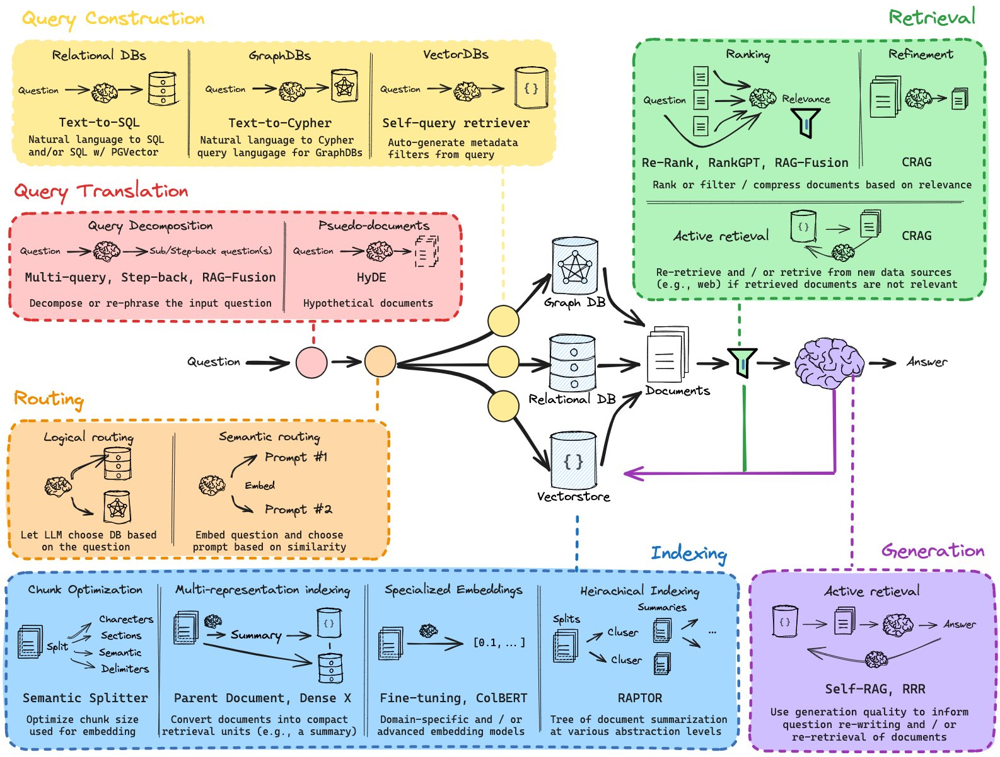

本页展示本站实际支持的写法。每项的“写法”可以直接复制，“效果”由同一套 Markdown 渲染器生成。如何组织内容、选择措辞和统一排版，见[文档格式约定](/zh/about/writing/)。

| 层次 | 本页内容 | 换到其他平台时 |
| --- | --- | --- |
| CommonMark 基础 | 标题、强调、列表、引用、分隔线、链接、图片、代码 | 通用性较好 |
| GFM 正式扩展 | 表格、任务列表、删除线、裸链接 | 需要 GFM 支持 |
| 内嵌 HTML | 键帽、折叠内容、上下标 | 取决于平台允许的 HTML 标签 |
| 本站插件与渲染增强 | 脚注、编号引用、提示块、公式、代码标签、标题锚点 | 需要相应插件或平台功能 |
| 发布元数据 | YAML frontmatter | 字段由博客框架定义 |

GFM 是以 CommonMark 为基础的扩展规范；“GitHub 页面能显示”不等于“写进了 GFM 正式规范”。本站启用 GFM，并保留下文列出的扩展功能。[CommonMark 规范](https://spec.commonmark.org/)、[GFM 规范](https://github.github.com/gfm/)

## CommonMark 基础

### 标题与段落

用 `#` 的数量表达标题层级，空行分隔段落。本站博文标题由 frontmatter 的 `title` 生成，正文通常从 `##` 开始。以下为避免打乱本页目录，用四级标题演示。

**写法**

```markdown
#### 一个小实验

先说明实验目的。

再说明输入条件和预期结果。
```

**效果**

#### 一个小实验

先说明实验目的。

再说明输入条件和预期结果。

### 强调、行内代码与转义

`**...**` 表示强强调，`*...*` 表示强调，反引号用于代码标识符。要显示语法字符本身，可在前面加反斜杠。具体语义选择见[文档格式约定](/zh/about/writing/)。

**写法**

```markdown
选择 **保存**，再调用 `save()`。

This is *emphasis*. 星号本身写成 \*。
```

**效果**

选择 **保存**，再调用 `save()`。

This is *emphasis*. 星号本身写成 \*。

### 列表与引用

步骤用有序列表，并列项目用无序列表。引用块用 `>`；引用他人内容时仍需标明来源。

**写法**

```markdown
1. 准备输入。
2. 运行实验。

- 记录观察结果。
- 保留失败案例。

> 这是一段用于演示排版的引用内容。
```

**效果**

1. 准备输入。
2. 运行实验。

- 记录观察结果。
- 保留失败案例。

> 这是一段用于演示排版的引用内容。

### 分隔线

单独一行写三个或更多短横线 `---`，可以分隔主题或内容段落。分隔线前后保留空行；若紧贴上一行文字，短横线可能被解释为二级标题的下划线。连续三个星号 `***` 或下划线 `___` 也能生成分隔线。

**写法**

```markdown
先记录实验结果。

---

再讨论结果的适用范围。
```

**效果**

先记录实验结果。

---

再讨论结果的适用范围。

### 链接与图片

链接写作 `[文字](地址)`，图片写作 ``。替代文本描述图片表达的信息；流程图也可以直接作为普通图片插入。

**写法**

```markdown
[返回关于作者](/zh/about/)


```

**效果**

[返回关于作者](/zh/about/)


图片语法属于基础 Markdown；本站额外提供独立图片的图注和放大阅读效果。

### 围栏代码块

用三个反引号包住代码，开头注明语言。若示例本身包含三个反引号，可用四个反引号包住外层。代码围栏属于基础语法，颜色高亮、行号和复制按钮属于本站渲染增强。点击右上角的复制图标会保留代码的缩进和换行，不包含行号。

**写法**

````markdown
```python
def double(value):
    return value * 2
```
````

**效果**

```python
def double(value):
    return value * 2
```

## GFM 正式扩展

以下四类写法均列在 [GFM 正式规范](https://github.github.com/gfm/)中。它们用于正文时无需额外标记或导入组件。

### 表格与列对齐

第一行是表头，第二行用短横线分隔。冒号决定列对齐；单元格中的竖线需要写成 `\|`。

表格会自动使用本站主题外观，无需额外标记。较宽的表格可以在表格区域内横向滚动；使用键盘时，先按 Tab 聚焦表格区域，再用左右方向键查看其余列。

**写法**

```markdown
| 方案 | 状态 | 用时（ms） |
| :--- | :---: | ---: |
| 顺序读取 | 已完成 | 24 |
| 缓存读取 | 已完成 | 8 |
| `A\|B` | 待验证 | 未测量 |
```

**效果**

| 方案 | 状态 | 用时（ms） |
| :--- | :---: | ---: |
| 顺序读取 | 已完成 | 24 |
| 缓存读取 | 已完成 | 8 |
| `A\|B` | 待验证 | 未测量 |

### 任务列表

`- [ ]` 表示未完成，`- [x]` 表示已完成。本站复选框用于展示，勾选状态来自 Markdown 源文件。

**写法**

```markdown
- [x] 创建最小示例。
- [ ] 添加边界条件。
```

**效果**

- [x] 创建最小示例。
- [ ] 添加边界条件。

### 删除线

用双波浪号标记已弃用或需要保留修改痕迹的内容。

**写法**

```markdown
~~旧方案：每次重新计算。~~ 新方案：复用已验证的结果。
```

**效果**

~~旧方案：每次重新计算。~~ 新方案：复用已验证的结果。

### 裸链接自动识别

GFM 可把直接写出的 URL 和邮箱转换成链接。正文中通常仍优先使用有说明文字的链接。

**写法**

```markdown
项目地址：https://example.com

示例邮箱：writer@example.com
```

**效果**

项目地址：https://example.com

示例邮箱：writer@example.com

## 内嵌 HTML

Markdown 可以包含 HTML。以下元素是 HTML 的语义功能，不是本站发明的 Markdown 方言；其他平台可能限制允许使用的标签。

### 键帽

`<kbd>` 表示用户输入的按键。本站为它提供键帽外观，写进文章不会自动注册快捷键。

**写法**

```html
保存：<kbd>Ctrl</kbd> + <kbd>S</kbd>；
macOS：<kbd>⌘</kbd> + <kbd>S</kbd>。
```

**效果**

保存：<kbd>Ctrl</kbd> + <kbd>S</kbd>；macOS：<kbd>⌘</kbd> + <kbd>S</kbd>。

### 折叠内容

用 `<details>` 包住内容，`<summary>` 写摘要。HTML 标签与内部 Markdown 之间保留空行。展开和收起不依赖 JavaScript。

**写法**

```markdown
<details>
<summary>查看推导思路</summary>

先确认**输入条件**，再推导结果。

- 写出已知量。
- 检查边界条件。

</details>
```

**效果**

<details>
<summary>查看推导思路</summary>

先确认**输入条件**，再推导结果。

- 写出已知量。
- 检查边界条件。

</details>

### 上下标

`<sub>` 表示下标，常用于化学式；`<sup>` 表示上标，可用于幂次或序号。

**写法**

```html
水的化学式是 H<sub>2</sub>O；平方可写作 x<sup>2</sup>。
```

**效果**

水的化学式是 H<sub>2</sub>O；平方可写作 x<sup>2</sup>。

## 本站插件与渲染增强

这些功能构成本站的扩展方言。其中一些也出现在 GitHub 等平台，但不属于上述 GFM 正式规范的扩展清单。复制到其他 Markdown 环境时，应确认其支持情况。

### 脚注与往返跳转

本站通过现有的 `remark-gfm` 实现支持脚注；该插件的支持范围包含脚注，但正式 GFM 规范没有定义脚注语法。正文写 `[^标识]`，另写同名定义。定义会集中到本页末尾，点击编号前往注释，再点击返回箭头回到原文。[插件说明](https://github.com/remarkjs/remark-gfm)

**写法**

```markdown
先运行最小示例，再逐步增加功能。[^small-example]

[^small-example]: 最小示例只保留重现问题所需的节点和代码。
```

**效果**

先运行最小示例，再逐步增加功能。[^small-example]

### GitHub 风格提示块

提示块采用 [GitHub 的 Alerts 写法](https://docs.github.com/en/get-started/writing-on-github/getting-started-with-writing-and-formatting-on-github/basic-writing-and-formatting-syntax#alerts)，由本站插件渲染。支持 `NOTE`、`TIP`、`IMPORTANT`、`WARNING`、`CAUTION`；信息提示用 `NOTE`，错误或危险操作提示用 `CAUTION`。`INFO`、`ERROR` 不是本站支持的标记。

**写法**

```markdown
> [!NOTE]
> 补充信息：示例使用 Godot 4 的节点生命周期。

> [!TIP]
> 小技巧：先写一个能运行的最小示例。

> [!IMPORTANT]
> 重要前提：先将脚本挂到场景中的节点上。

> [!WARNING]
> 注意：修改共享资源会影响使用它的所有实例。

> [!CAUTION]
> 危险操作：删除文件前，请先确认已有备份。
```

**效果**

> [!NOTE]
> 补充信息：示例使用 Godot 4 的节点生命周期。

> [!TIP]
> 小技巧：先写一个能运行的最小示例。

> [!IMPORTANT]
> 重要前提：先将脚本挂到场景中的节点上。

> [!WARNING]
> 注意：修改共享资源会影响使用它的所有实例。

> [!CAUTION]
> 危险操作：删除文件前，请先确认已有备份。

### 正文编号与交叉引用

用 `:::numbered{#标识}` 为一段定义、说明或公式设置引用目标，用 `:ref[标识]` 在后文引用。目标内容保留在原位置，右侧显示 `(1)`、`(2)` 等编号；点击后文的编号会跳回对应内容。

标识使用小写英文字母开头，可包含数字和连字符，例如 `idempotency`、`energy-law`。编号按目标在本篇正文中的顺序生成；移动或插入目标时，引用编号会一起更新。可以多次引用同一个目标，也可以引用后面才出现的目标。

**写法**

```markdown
:::numbered{#idempotency}
**幂等性**：对同一对象重复执行某个操作，产生的最终状态与执行一次相同。
:::

后文讨论重试时，可以回看幂等性的定义 :ref[idempotency]。
```

**效果**

:::numbered{#idempotency}
**幂等性**：对同一对象重复执行某个操作，产生的最终状态与执行一次相同。
:::

后文讨论重试时，可以回看幂等性的定义 :ref[idempotency]。

这类引用指向正文中的已有内容；前面的脚注则把补充说明集中到文末，两者可以同时使用。本站使用 [remark-directive](https://github.com/remarkjs/remark-directive) 解析指令，并在构建时生成编号和链接，关闭 JavaScript 也能跳转。重复标识或引用不存在的标识会在构建时报告错误。

### 数学公式与编号引用

公式由 `remark-math` 与 KaTeX 渲染。行内用 `$...$`，独立公式用单独成行的 `$$` 包围。本站自动识别公式并加载样式，代码围栏中的公式保持原样。[公式插件说明](https://github.com/remarkjs/remark-math)

需要引用某个公式时，把它放入同一种编号块中。符号含义就近说明，后文用编号回到公式。

**写法**

```markdown
平均速度为 $v = \frac{d}{t}$。

:::numbered{#energy}
$$
E = mc^2
$$
:::

其中，$E$ 表示能量，$m$ 表示质量，$c$ 表示真空中的光速。

后文再次使用质能关系时，参见公式 :ref[energy]。
```

**效果**

平均速度为 $v = \frac{d}{t}$。

:::numbered{#energy}
$$
E = mc^2
$$
:::

其中，$E$ 表示能量，$m$ 表示质量，$c$ 表示真空中的光速。

后文再次使用质能关系时，参见公式 :ref[energy]。本页前面已有一个编号目标，因此这个公式自动编号为 `(2)`。

### 多标签代码组

用 `::: code-group` 包住多个普通代码块，`labels` 按顺序对应每个代码块。围栏上的语言名控制高亮，标签控制显示名称。语法和切换由 [rehype-code-group](https://github.com/ITZSHOAIB/rehype-code-group) 提供，本站为每个版本独立显示行号；点击复制图标只复制当前选中的版本。

**写法：GDScript 与 C#**

````markdown
::: code-group labels=[GDScript, C#]

```gdscript
extends Node

func _ready():
    print("Hello, Godot!")
```

```csharp
using Godot;

public partial class Hello : Node
{
    public override void _Ready()
    {
        GD.Print("Hello, Godot!");
    }
}
```

:::
````

**效果**

::: code-group labels=[GDScript, C#]

```gdscript
extends Node

func _ready():
    print("Hello, Godot!")
```

```csharp
using Godot;

public partial class Hello : Node
{
    public override void _Ready()
    {
        GD.Print("Hello, Godot!");
    }
}
```

:::

需要多组代码时，重复使用 `::: code-group`，每组独立切换、互不影响。其他语言同样使用这套语法，围栏语言名与 `labels` 按实际代码填写。

标签获得焦点后，可用左右方向键、Home 和 End 切换；禁用 JavaScript 时，各语言版本按顺序显示。

### 标题锚点与阅读增强

本站为标题自动生成锚点，并用二、三级标题生成目录。链接语法属于 CommonMark，标题如何生成锚点则由渲染器决定；重复标题的锚点会带后缀，分享时应复制实际链接。

**写法**

```markdown
[跳到锚点示例](#锚点示例)

#### 锚点示例

这里是链接的目标位置。
```

**效果**

[跳到锚点示例](#锚点示例)

#### 锚点示例

这里是链接的目标位置。语法高亮、代码复制、图片放大和目录导航均由站点提供，不需要在每篇文章中编写脚本。

## 发布元数据

### Frontmatter 写法

YAML frontmatter 放在 Markdown 文件最前面，两条 `---` 之间。它描述文章信息，不是正文，也不属于 CommonMark 或 GFM；字段由本站内容模型定义。保存到 `posts/zh/hello-markdown.md` 后，下面的示例会得到 `/zh/posts/hello-markdown/` 路径。英文版放在 `posts/en/hello-markdown.md`，两份文件使用相同的 `translationKey`。

**写法**

```yaml
---
title: 用 Markdown 写一篇博文
description: 记录一个可复现的小实验。
pubDate: 2026-11-04
category: writing
tags: [Markdown, 写作]
locale: zh
translationKey: hello-markdown
draft: true
---
```

**生成效果**

| 字段 | 必填 | 作用 |
| --- | --- | --- |
| `title` | 是 | 页面标题和文章列表标题 |
| `pubDate` | 是 | 发布日期和文章排序 |
| `category` | 是 | 分类索引，使用小写英文字母、数字和连字符 |
| `locale` | 是 | 内容语言：`zh` 或 `en` |
| `translationKey` | 是 | 中英文共享的稳定标识，区分大小写 |
| `description` | 否 | 摘要与页面描述 |
| `tags` | 否 | 标签索引，省略时为空 |
| `subcategory` | 否 | 子分类标识，格式与分类相同 |
| `updatedDate` | 否 | 最近更新日期 |
| `pin` | 否 | 置顶标记，默认 `false` |
| `draft` | 否 | 草稿标记，默认 `false` |

### 预览、发布与删除

设置 `draft: true` 后，运行 `npm run dev`，在本地 `/zh/drafts/` 预览；生产构建不会生成这篇草稿的文章或索引。草稿可以暂时只有一种语言。准备发布时，须提供相同 `translationKey` 的中英文版本，并把两份都改为 `draft: false`；已发布文章必须具备已发布的对应译文。新增或删除文章后，下次构建会更新文章列表、分类、标签、归档、RSS、站点地图和搜索索引。

不需要逐篇维护索引配置或书房字体。`name`、`desc`、`latex` 不是本文档采用的发布字段，请使用上表中的名称。流程图使用普通图片，本站不提供 Mermaid 渲染。

[^small-example]: 最小示例只保留重现问题所需的节点和代码。
