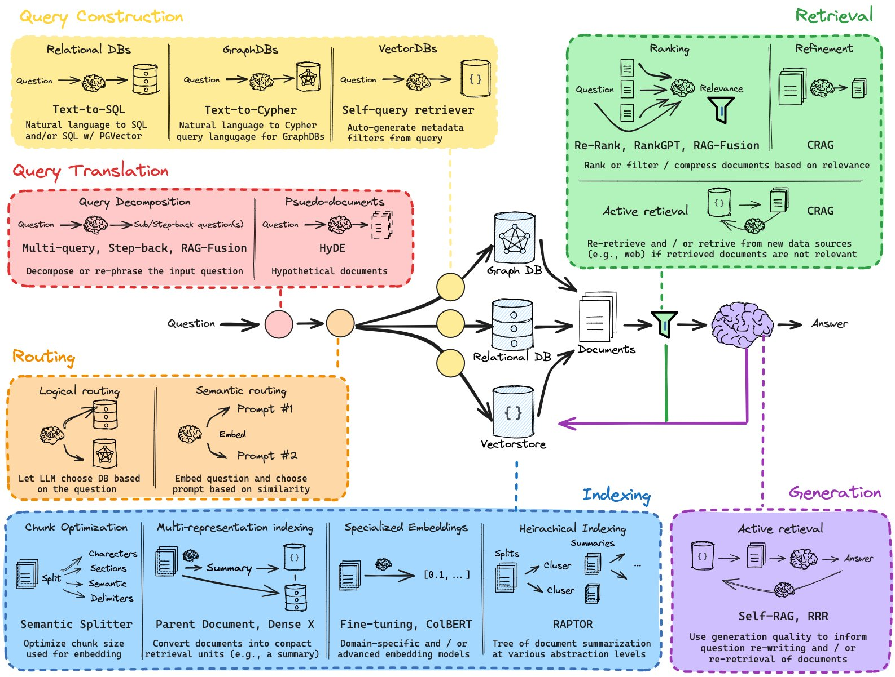

本文说明如何在本站写作与修订博文：如何新建草稿并发布，如何按内容语义选择格式，以及本站实际支持的 Markdown 写法。目标是让读者容易找到信息、理解表达，并准确复现示例。

预览前需要已检出本仓库、安装项目依赖，并使用 Node.js 22.23.4 或更高版本。下文命令均在项目根目录运行。

## 从草稿到发布

### 从一个 Markdown 文件开始

在 `posts/zh/` 新建 `my-note.md`，并设置 `key: my-note`，文章地址就是 `/zh/posts/my-note/`。英文版放在 `posts/en/`，两份文件使用相同的 `key`。文章语言由所在目录推导，无需填写 `locale`。

```yaml
---
title: 我的新笔记
description: 用一句话介绍这篇文章。
date: 2026-11-04
category: writing
tags: [markdown]
key: my-note
draft: true
---
```

`title`、`date`、`category` 和 `key` 必填。分类使用小写字母、数字和连字符，例如 `travel-notes`；标签可以直接写中文。文章发布后，新分类和标签会自动出现在索引中，无需手动登记。

`draft: true` 表示草稿。草稿可以暂时只有一种语言。预览和发布步骤如下：

1. 在项目根目录运行 `npm run dev`。
2. 在中文导航中选择**草稿**，打开文章并检查渲染效果。
3. 准备具有相同 `key` 的中英文版本，删除两份文件中的 `draft: true`，或都改成 `false`。
4. 确认准备公开后，将文件推送或合并到 `main`。这会触发网站部署流程。

日期用于展示和排序，不会自动预约发布。

#### 字段说明

**生成效果**

| 字段 | 必填 | 作用 |
| --- | --- | --- |
| `title` | 是 | 页面标题和文章列表标题 |
| `date` | 是 | 发布日期和文章排序 |
| `category` | 是 | 分类索引，使用小写英文字母、数字和连字符 |
| `key` | 是 | 中英文共享的稳定标识，区分大小写 |
| `description` | 否 | 摘要与页面描述 |
| `tags` | 否 | 标签索引，省略时为空 |
| `subcategory` | 否 | 子分类标识，格式与分类相同 |
| `updatedDate` | 否 | 最近更新日期 |
| `pin` | 否 | 置顶标记，默认 `false` |
| `draft` | 否 | 草稿标记，默认 `false` |

生产构建不会生成草稿的文章或索引。已发布文章必须具备已发布的对应译文。新增或删除文章后，下次构建会更新文章列表、分类、标签、归档、RSS、站点地图和搜索索引。

不需要逐篇维护索引配置。`name`、`desc`、`latex` 不是本站采用的发布字段。流程图使用普通图片，本站不提供 Mermaid 渲染。

### 发布后自动出现的入口

文章发布后，博客首页、分类、标签、归档、RSS 和全文搜索都会随构建更新。正文的二、三级标题会自动生成目录。

普通链接也使用 Markdown。链接另一篇文章时，填写最终页面地址（例如 [关于作者](/zh/about/)），不使用源文件的 `.md` 路径。
## 格式约定

本文用于写作和修订本站博文。目标是让读者容易找到信息、理解表达，并准确复现示例。格式服务于内容：先判断文字承担什么作用，再选择标题、列表、代码或注释。

### 适用范围与参考依据

技术文档的组织与表达以 [Google 开发者文档写作指南](https://developers.google.com/style)为主，[Microsoft 写作指南](https://learn.microsoft.com/en-us/style-guide/welcome/)为辅。中文用词与排版参考[阮一峰《中文技术文档的写作规范》](https://github.com/ruanyf/document-style-guide)和[《中文文案排版指北》](https://github.com/sparanoid/chinese-copywriting-guidelines)。这些是公开的写作指南，不是对所有文体都适用的统一强制标准。

遇到差异时，按以下方式处理：

1. 代码、命令、产品名、界面原文和直接引文保持准确，不能为了排版改动其内容。
2. 技术信息的结构与语义采用 Google 的建议；Google 未涉及的操作说明等问题参考 Microsoft。
3. 中文标点、混排与措辞按中文指南处理。中文和数字间统一留空格，采用《排版指北》的选择；中文引号采用阮一峰指南中的双引号“”与内层单引号‘’。
4. 英文指南中的美式标点、英文标题大小写和斜体习惯只用于相应语境。中文标题、书名和日期按中文习惯表达。

这些选择用于保持文章之间的一致性，不把其他合法风格判为语法错误。经验随笔可以保留个人语气，教程则应优先保证步骤完整和结果可验证。

### 文档结构

#### 标题与层级

标题说明文章解决的问题或讨论的概念，例如“为 Godot 场景添加暂停菜单”或“资源加载与实例创建”。避免只写“记录一下”“一些问题”等无法独立理解的标题。

一篇文章只有一个主标题。本站使用文章头部的 `title` 生成主标题，正文从 `##` 开始，子节使用 `###`，不跳过层级。不要通过加粗普通段落来冒充标题，也不要为了缩小字号而使用更深的标题。

同级标题采用相近的表达方式。操作教程可使用“创建场景”“连接信号”“验证结果”；概念说明可使用“输入条件”“状态转换”“边界情况”。只有一小段内容时不必再拆子节，长篇内容再按需要增加层级。

依据：[Google 标题指南](https://developers.google.com/style/headings)、[中文标题规范](https://github.com/ruanyf/document-style-guide/blob/master/docs/title.md)。

#### 段落与阅读顺序

开头交代主题、适用范围和读完可以获得什么。一个段落围绕一个中心展开，先给结论或关键事实，再提供原因、例子和限制。需要比较不同情况时，用明确的小标题组织。

Markdown 段落之间留一个空行，段首不输入全角空格。不要用连续空格、手动换行或 `<br>` 模拟缩进和布局。段落长短以读者能否顺畅理解为准，不以某台屏幕显示了几行作为硬性标准。

依据：[中文段落规范](https://github.com/ruanyf/document-style-guide/blob/master/docs/paragraph.md)。

### 叙述与操作步骤

#### 事实、解释与判断

尽量写清楚谁执行什么动作，以及动作产生什么结果。用“应用在请求超时后调用 `onTimeout()`”代替主语不明的“超时后会被调用”。解释条件时，先写条件再写操作，例如“如果需要保留原始资源，请先创建副本”。

使用读者熟悉的词语，拆开同时包含多个条件的长句。明确区分实测结果、文档规定和个人推测；性能结论应同时说明测试条件，避免把一次观察写成所有环境都成立的结论。不用“显然”“非常简单”等词代替必要解释。

依据：[Google 写作要点](https://developers.google.com/style/highlights)。

#### 教程与验证

有先后关系的操作使用编号步骤。步骤开始前给出所需软件版本、文件、权限或已有状态。每步以动作开始，必要时先说明操作位置，随后给出预期结果。

例如，介绍编辑器中的操作可以写成：

1. 在场景树中选择目标节点。
2. 在检查器中找到 **Process**，将 **Mode** 设置为 **Always**。
3. 运行场景并暂停，确认该节点仍能处理输入。

可选步骤明确写“可选”。分支较多时拆成独立小节，不把不同平台的步骤交错排列。复现错误时列出触发条件、实际结果和预期结果；修复说明应包含验证方法。

依据：[Google 操作步骤](https://developers.google.com/style/procedures)、[Microsoft 分步说明](https://learn.microsoft.com/en-us/style-guide/procedures-instructions/writing-step-by-step-instructions)。

### 术语与文本语义

#### 名称、术语与缩写

产品名称保持官方大小写，如 Godot、GitHub、TypeScript。普通技术概念优先使用清楚且通行的中文译名，同一篇文章不要无说明地切换译法。

读者可能不熟悉的术语，在首次出现时解释。需要反复使用缩写时，先给出完整名称，例如“抽象语法树（abstract syntax tree，AST）”，后文再使用 AST。只有一次出现的词通常不必再创造缩写。API、HTML 等是否需要展开，取决于文章面向的读者。

依据：[Google 缩写指南](https://developers.google.com/style/abbreviations)、[中文文案排版指北：名词](https://github.com/sparanoid/chinese-copywriting-guidelines/blob/master/README.zh-Hans.md#名词)。

#### 选择有含义的格式

按文字的用途选择标记，而不是给不同字号或颜色另设一套含义。

| 内容语义 | 表达方式 | 示例 |
| --- | --- | --- |
| 代码中的名称或字面值 | 行内代码 | 类 `TreeNode`、方法 `_ready()`、参数 `timeout`、值 `false` |
| 文件、路径、命令及选项 | 行内代码 | `project.godot`、`src/main.ts`、`npm run dev`、`--port` |
| 界面上可见的标签 | 加粗，并保持界面原文 | 选择 **文件**，然后选择 **保存** |
| 段内的小标题 | 简短加粗标签 | **前提：** 已创建场景 |
| 语气上的强调 | 优先通过措辞表达，必要时少量强调 | *仅在首次加载时*创建资源 |
| 键盘按键 | 按键名或 `<kbd>` | <kbd>Ctrl</kbd> + <kbd>S</kbd> |
| 引用别人的文字 | 引号或引用块，并注明来源 | 与作者自己的解释分开 |
| 补充解释或出处 | 普通说明或脚注 | 不影响主线的背景放入脚注 |

类名与关键字属于代码标识符，使用行内代码。普通产品名按正文排版。重要程度应通过文字表达，颜色可以辅助区分。`<sub>` 和 `<sup>` 分别表达下标与上标，适用于化学式和幂次等内容。

依据：[Google 文字格式](https://developers.google.com/style/text-formatting)、[行内代码](https://developers.google.com/style/code-in-text)、[数学记号](https://developers.google.com/style/mathematical-notation)。

#### 界面、键盘与提示

界面标签按所述版本实际显示的文字书写。必要时注明语言与平台，不能让读者猜测中文标签对应哪个英文选项。较长菜单路径写成完整操作句，避免只依靠箭头说明顺序。

组合键中的 `+` 表示同时按下；先后按键写成“先按……，再按……”。macOS 和 Windows 使用不同按键时分别列出，不把 `Ctrl` 和 `Command` 当作可互换名称。键帽只是展示按键的标记，不会为页面注册快捷键。

提示块只承载需要突出的小段补充或风险说明。完成任务必需的前提和步骤仍放在正文；不要把整篇文章包成一串提示框。提示类型的名字与具体写法见下文「GitHub 风格提示块」，不直接把其他平台的类型名称套过来。

依据：[Microsoft 键盘快捷键](https://learn.microsoft.com/en-us/style-guide/a-z-word-list-term-collections/term-collections/keys-keyboard-shortcuts)、[Google 提示说明](https://developers.google.com/style/notices)。

### 代码与命令示例

代码前说明示例的目的、运行位置和必要前提；代码后解释关键行或预期输出。使用带语言名称的围栏代码块，保留可复制的文本。缩进遵循示例语言及项目的规范，不为统一外观把所有语言改成同一种缩进。

例如，在项目目录启动开发服务器：

```sh
npm run dev
```

输入命令和示例输出分开，不把终端提示符 `$`、`>` 或输出内容混进可直接复制的命令。标为“可运行”的示例应包含运行所需的部分；片段应说明省略了哪些内容，省略位置使用该语言的注释。

需要读者替换的值使用有含义的占位符，并在紧邻位置解释：

```sh
git clone REPOSITORY_URL
```

将 `REPOSITORY_URL` 替换为目标仓库地址。不要依赖占位符的颜色区分它与真实值，也不要在需要替换的地方使用含义不明的 `xxx`。命令中的引号、大小写和空格按实际语法保留，不能改成中文标点。

不同语言实现同一任务时，可以使用代码标签组。各标签应说明同一种行为，并保持示例前提一致；不能把执行顺序中的两步藏进互斥标签。操作具有覆盖、删除等后果时，在命令前写明影响对象与恢复条件。

依据：[Google 代码示例](https://developers.google.com/style/code-samples)、[占位符](https://developers.google.com/style/placeholders)。

### 中文排版

#### 中西文与空格

中文与英文、阿拉伯数字之间留一个半角空格；数字与大多数单位符号之间也留空格。全角标点两侧不额外留空格。产品官方名称、直接引文以及代码中的字符串保持原样。

| 情况 | 示例 |
| --- | --- |
| 中文与英文混排 | 使用 Godot 创建场景。 |
| 中文与数字混排 | 共有 3 个节点。 |
| 数值与单位 | 延迟为 20 ms，内存为 512 MB。 |
| 百分比与角度 | 成功率为 98%，旋转角度为 45°。 |
| 全角标点前后 | 选择 Node，然后运行。 |

阮一峰的指南允许中文与数字之间采用有空格或无空格的统一风格；本站采用《排版指北》的留空格方式。不要为了给中文链接增加视觉间隔而机械插入空格，应按链接文字与前后文字的实际语言判断。

依据：[中文文本规范：字间距](https://github.com/ruanyf/document-style-guide/blob/master/docs/text.md)、[中文文案排版指北：空格](https://github.com/sparanoid/chinese-copywriting-guidelines/blob/master/README.zh-Hans.md#空格)。

#### 标点、引号与书名

中文句子使用中文标点，例如 `，。；：？！`；完整英文句子使用英文标点。中文句子中并列的名称用顿号分隔，例如“GDScript、C# 和 Python”。代码、URL、文件名中的符号保持原样。

中文引用使用“”，引用中再次引用使用‘’；补充说明使用（）。中文书名、文章名使用《》，英文作品名可使用斜体或具有明确名称的链接。省略号使用“……”，不使用“。。。”；普通说明不连续叠加问号或感叹号。

标题通常不加句末句号。段落应正常分句，不把多层意思全部用逗号连接。网页中的行首行尾排版由页面处理，不靠在 Markdown 中插入空格或手动折行来修补。

依据：[中文标点规范](https://github.com/ruanyf/document-style-guide/blob/master/docs/marks.md)、[中文文案排版指北：全角和半角](https://github.com/sparanoid/chinese-copywriting-guidelines/blob/master/README.zh-Hans.md#全角和半角)。

### 数字、单位与时间

技术数值采用半角数字，并说明单位、精度和口径。不要将未知值写成 `0`，也不要把“增加 10%”与“增加 10 个百分点”混为一谈。说明结果时，保留足以支撑结论的精度。

| 内容 | 表达示例与注意事项 |
| --- | --- |
| 普通数量 | `12,500` 次请求；编号、年份、端口号不添加千位分隔符 |
| 区间 | `10 ms 至 30 ms`，两端写明单位；需要时说明是否包含端点 |
| 容量 | 区分 `MB` 与 `MiB`，采用被讨论系统实际使用的单位 |
| 温度与角度 | `25 °C` 表示温度；`45°` 表示角度，两者的空格不同 |
| 货币 | `100 美元` 或 `100 新加坡元`，避免含义不明的货币符号 |
| 日期 | `2026 年 11 月 4 日`，纯数字格式使用 `2026-11-04` |
| 时刻 | `14:30`；跨地区事件补充时区，例如“新加坡时间（UTC+08:00）” |

数字与单位不宜在显示时分行，需要保持相连时可写 `20&nbsp;ms`。版本号按原样书写，例如 `1.2.0`；它不是小数，不能省略末尾的 `0`。日志和代码中的时间戳按原格式保留，涉及跨时区比较时说明换算方式。

依据：[中文数值规范](https://github.com/ruanyf/document-style-guide/blob/master/docs/number.md)、[Google 计量单位](https://developers.google.com/style/units-of-measure)、[日期与时间](https://developers.google.com/style/dates-times)。本文的中文叙述采用 24 小时制，不照搬英文指南的 AM／PM 表达。

### 列表、表格与图片

#### 列表与表格

有顺序的步骤、阶段使用编号列表；无顺序的并列事项使用项目列表。同一列表中的项目保持相近语法结构。完整句子以句号结尾，短语列表可以不加句号，但同组保持一致。

表格适合比较同类对象的多个属性，例如参数名、类型、默认值和用途。列名写清含义与单位，空值应说明是“不适用”“未提供”还是“未测量”。长段落、操作流程和多行代码放在正文中，避免挤进表格。复杂对比可拆成多个小表，便于手机阅读。

依据：[Google 列表](https://developers.google.com/style/lists)、[表格](https://developers.google.com/style/tables)。

#### 图表、截图与替代文本

图片用于展示文字难以说明的结构、流程或界面。代码、报错和终端输出优先保留为文本；流程图可以作为普通图片插入。

有信息的图片填写替代文本，描述它传达的主要内容，而不是只写“图片”或文件名。复杂图表在正文补充关键关系与结论，不能让读者必须看见图片才能理解文章。纯装饰图片使用空替代文本。

截图裁剪到讨论区域，图表标明单位和图例，外部图片注明作者或来源。不要只用红绿颜色区分不同状态，应配合文字或符号。插图前说明它与正文的关系，必要时在下方补充说明。

依据：[Google 图片指南](https://developers.google.com/style/images)。

### 链接、引用与注释

链接文字应说明目标，例如“查看资源加载文档”，避免只写“这里”。链接到支持当前说明的具体页面或章节，优先采用原始文档、标准、论文或项目来源。本站链接使用稳定页面地址，章节链接指向真实存在的标题。

直接引文明确标出引用边界，并给出作者和出处；自己的概括不能伪装成原话。引用数据、结论和外部图片时，把来源放在相关内容附近。长篇转载或翻译应说明原作者、原文地址及相应许可。

脚注用于不打断主线的补充解释或出处。完成操作必需的信息留在正文，不藏在脚注中。每个脚注使用能辨认用途的标识，避免依赖手工编号；实际编号由页面生成。首次理解公式所需的符号定义应就近给出。

需要在后文回到已定义的术语、段落或公式时，使用正文编号交叉引用。目标内容保留在原位置，后文通过 `(1)`、`(2)` 这样的链接跳转，写法见下文「正文编号与交叉引用」。

引用块表示引文，提示块承载作者的补充提示，按内容的用途选择。

依据：[Google 链接指南](https://developers.google.com/style/cross-references)、[中文段落规范：引用](https://github.com/ruanyf/document-style-guide/blob/master/docs/paragraph.md)。

### 数学表达

短公式可以放在句中，例如 $v = d/t$；需要单独讨论的公式另起一行。公式中的符号在首次出现附近定义，同一符号在同一语境中保持同一含义。

例如，平均速度可表示为：

$$
v = \frac{d}{t}
$$

其中，$d$ 是路程，$t$ 是经过的时间，且 $t > 0$。若 $d$ 以米计、$t$ 以秒计，$v$ 的单位为米每秒。条件和单位属于公式解释的一部分，应与公式一起提供。

数学变量、运算符与上下标交给公式排版处理，不靠手工空格对齐。代码中的 `x * y` 是程序表达式，正文中的数学乘法可写为 $x \times y$，两者按所讨论的语境选择。复杂推导分步说明，并用文字解释结果的含义。

依据：[Google 数学记号](https://developers.google.com/style/mathematical-notation)。本站的公式输入方式见下文「数学公式与编号引用」。

### 适用版本与修订

教程开头说明对结果有影响的软件版本、平台和测试条件。容易随时间变化的信息应有查询或验证日期，避免使用缺少时间背景的“最新版”“目前都支持”等表述。

文章修改结论或关键步骤时，更新适用范围，并简短说明有意义的勘误。实质更新可填写文章的 `updatedDate`；拼写和标点修正不必附带冗长的更新记录。保留旧版本说明时明确标注适用版本，避免新旧步骤混在一起。

发布前检查读者能否沿着正文完成任务：标题与内容是否对应，术语是否一致，命令是否完整，链接与脚注是否可达，图片和公式是否有必要说明。语法细节见下文「语法与效果」；发布字段见上文「从草稿到发布」。

## 语法与效果

本站按层次展示实际支持的写法。每项的“写法”可以直接复制，“效果”由同一套 Markdown 渲染器生成。发布字段见上文「从草稿到发布」。

| 层次 | 本页内容 | 换到其他平台时 |
| --- | --- | --- |
| CommonMark 基础 | 标题、强调、列表、引用、分隔线、链接、图片、代码 | 通用性较好 |
| GFM 正式扩展 | 表格、任务列表、删除线、裸链接 | 需要 GFM 支持 |
| 内嵌 HTML | 键帽、折叠内容、上下标 | 取决于平台允许的 HTML 标签 |
| 本站插件与渲染增强 | 脚注、编号引用、提示块、公式、代码标签、标题锚点 | 需要相应插件或平台功能 |

GFM 是以 CommonMark 为基础的扩展规范；“GitHub 页面能显示”不等于“写进了 GFM 正式规范”。本站启用 GFM，并保留下文列出的扩展功能。[CommonMark 规范](https://spec.commonmark.org/)、[GFM 规范](https://github.github.com/gfm/)

### CommonMark 基础

#### 标题与段落

用 `#` 的数量表达标题层级，空行分隔段落。本站博文标题由 frontmatter 的 `title` 生成，正文通常从 `##` 开始。以下为避免打乱本页目录，用四级标题演示。

**写法**

```markdown
#### 一个小实验

先说明实验目的。

再说明输入条件和预期结果。
```

**效果**

##### 一个小实验

先说明实验目的。

再说明输入条件和预期结果。

#### 强调、行内代码与转义

`**...**` 表示强强调，`*...*` 表示强调，反引号用于代码标识符。要显示语法字符本身，可在前面加反斜杠。具体语义选择见上文「格式约定」。

**写法**

```markdown
选择 **保存**，再调用 `save()`。

This is *emphasis*. 星号本身写成 \*。
```

**效果**

选择 **保存**，再调用 `save()`。

This is *emphasis*. 星号本身写成 \*。

#### 列表与引用

步骤用有序列表，并列项目用无序列表。引用块用 `>`；引用他人内容时仍需标明来源。

**写法**

```markdown
1. 准备输入。
2. 运行实验。

- 记录观察结果。
- 保留失败案例。

> 这是一段用于演示排版的引用内容。
```

**效果**

1. 准备输入。
2. 运行实验。

- 记录观察结果。
- 保留失败案例。

> 这是一段用于演示排版的引用内容。

#### 分隔线

单独一行写三个或更多短横线 `---`，可以分隔主题或内容段落。分隔线前后保留空行；若紧贴上一行文字，短横线可能被解释为二级标题的下划线。连续三个星号 `***` 或下划线 `___` 也能生成分隔线。

**写法**

```markdown
先记录实验结果。

---

再讨论结果的适用范围。
```

**效果**

先记录实验结果。

---

再讨论结果的适用范围。

#### 链接与图片

链接写作 `[文字](地址)`，图片写作 ``。替代文本描述图片表达的信息；流程图也可以直接作为普通图片插入。

**写法**

```markdown
[返回关于作者](/zh/about/)


```

**效果**

[返回关于作者](/zh/about/)

图片语法属于基础 Markdown；本站额外提供独立图片的图注和放大阅读效果。流程图示例见下文「图片也可以表达流程」。

#### 围栏代码块

用三个反引号包住代码，开头注明语言。若示例本身包含三个反引号，可用四个反引号包住外层。代码围栏属于基础语法，颜色高亮、行号和复制按钮属于本站渲染增强。点击右上角的复制图标会保留代码的缩进和换行，不包含行号。

**写法**

````markdown
```python
def double(value):
    return value * 2
```
````

**效果**

```python
def double(value):
    return value * 2
```

### GFM 正式扩展

以下四类写法均列在 [GFM 正式规范](https://github.github.com/gfm/)中。它们用于正文时无需额外标记或导入组件。

#### 表格与列对齐

第一行是表头，第二行用短横线分隔。冒号决定列对齐；单元格中的竖线需要写成 `\|`。

表格会自动使用本站主题外观，无需额外标记。较宽的表格可以在表格区域内横向滚动；使用键盘时，先按 Tab 聚焦表格区域，再用左右方向键查看其余列。

**写法**

```markdown
| 方案 | 状态 | 用时（ms） |
| :--- | :---: | ---: |
| 顺序读取 | 已完成 | 24 |
| 缓存读取 | 已完成 | 8 |
| `A\|B` | 待验证 | 未测量 |
```

**效果**

| 方案 | 状态 | 用时（ms） |
| :--- | :---: | ---: |
| 顺序读取 | 已完成 | 24 |
| 缓存读取 | 已完成 | 8 |
| `A\|B` | 待验证 | 未测量 |

#### 任务列表

`- [ ]` 表示未完成，`- [x]` 表示已完成。本站复选框用于展示，勾选状态来自 Markdown 源文件。

**写法**

```markdown
- [x] 创建最小示例。
- [ ] 添加边界条件。
```

**效果**

- [x] 创建最小示例。
- [ ] 添加边界条件。

#### 删除线

用双波浪号标记已弃用或需要保留修改痕迹的内容。

**写法**

```markdown
~~旧方案：每次重新计算。~~ 新方案：复用已验证的结果。
```

**效果**

~~旧方案：每次重新计算。~~ 新方案：复用已验证的结果。

#### 裸链接自动识别

GFM 可把直接写出的 URL 和邮箱转换成链接。正文中通常仍优先使用有说明文字的链接。

**写法**

```markdown
项目地址：https://example.com

示例邮箱：writer@example.com
```

**效果**

项目地址：https://example.com

示例邮箱：writer@example.com

### 内嵌 HTML

Markdown 可以包含 HTML。以下元素是 HTML 的语义功能，不是本站发明的 Markdown 方言；其他平台可能限制允许使用的标签。

#### 键帽

`<kbd>` 表示用户输入的按键。本站为它提供键帽外观，写进文章不会自动注册快捷键。

**写法**

```html
保存：<kbd>Ctrl</kbd> + <kbd>S</kbd>；
macOS：<kbd>⌘</kbd> + <kbd>S</kbd>。
```

**效果**

保存：<kbd>Ctrl</kbd> + <kbd>S</kbd>；macOS：<kbd>⌘</kbd> + <kbd>S</kbd>。

#### 折叠内容

用 `<details>` 包住内容，`<summary>` 写摘要。HTML 标签与内部 Markdown 之间保留空行。展开和收起不依赖 JavaScript。

**写法**

```markdown
<details>
<summary>查看推导思路</summary>

先确认**输入条件**，再推导结果。

- 写出已知量。
- 检查边界条件。

</details>
```

**效果**

<details>
<summary>查看推导思路</summary>

先确认**输入条件**，再推导结果。

- 写出已知量。
- 检查边界条件。

</details>

#### 上下标

`<sub>` 表示下标，常用于化学式；`<sup>` 表示上标，可用于幂次或序号。

**写法**

```html
水的化学式是 H<sub>2</sub>O；平方可写作 x<sup>2</sup>。
```

**效果**

水的化学式是 H<sub>2</sub>O；平方可写作 x<sup>2</sup>。

### 本站插件与渲染增强

这些功能构成本站的扩展方言。其中一些也出现在 GitHub 等平台，但不属于上述 GFM 正式规范的扩展清单。复制到其他 Markdown 环境时，应确认其支持情况。

#### 脚注与往返跳转

本站通过现有的 `remark-gfm` 实现支持脚注；该插件的支持范围包含脚注，但正式 GFM 规范没有定义脚注语法。正文写 `[^标识]`，另写同名定义。定义会集中到本页末尾，点击编号前往注释，再点击返回箭头回到原文。[插件说明](https://github.com/remarkjs/remark-gfm)

**写法**

```markdown
先运行最小示例，再逐步增加功能。[^small-example]

```

**效果**

先运行最小示例，再逐步增加功能。[^small-example]

#### GitHub 风格提示块

提示块采用 [GitHub 的 Alerts 写法](https://docs.github.com/en/get-started/writing-on-github/getting-started-with-writing-and-formatting-on-github/basic-writing-and-formatting-syntax#alerts)，由本站插件渲染。支持 `NOTE`、`TIP`、`IMPORTANT`、`WARNING`、`CAUTION`；信息提示用 `NOTE`，错误或危险操作提示用 `CAUTION`。`INFO`、`ERROR` 不是本站支持的标记。

**写法**

```markdown
> [!NOTE]
> 补充信息：示例使用 Godot 4 的节点生命周期。

> [!TIP]
> 小技巧：先写一个能运行的最小示例。

> [!IMPORTANT]
> 重要前提：先将脚本挂到场景中的节点上。

> [!WARNING]
> 注意：修改共享资源会影响使用它的所有实例。

> [!CAUTION]
> 危险操作：删除文件前，请先确认已有备份。
```

**效果**

> [!NOTE]
> 补充信息：示例使用 Godot 4 的节点生命周期。

> [!TIP]
> 小技巧：先写一个能运行的最小示例。

> [!IMPORTANT]
> 重要前提：先将脚本挂到场景中的节点上。

> [!WARNING]
> 注意：修改共享资源会影响使用它的所有实例。

> [!CAUTION]
> 危险操作：删除文件前，请先确认已有备份。

#### 正文编号与交叉引用

用 `:::numbered{#标识}` 为一段定义、说明或公式设置引用目标，用 `:ref[标识]` 在后文引用。目标内容保留在原位置，右侧显示 `(1)`、`(2)` 等编号；点击后文的编号会跳回对应内容。

标识使用小写英文字母开头，可包含数字和连字符，例如 `idempotency`、`energy-law`。编号按目标在本篇正文中的顺序生成；移动或插入目标时，引用编号会一起更新。可以多次引用同一个目标，也可以引用后面才出现的目标。

**写法**

```markdown
:::numbered{#idempotency}
**幂等性**：对同一对象重复执行某个操作，产生的最终状态与执行一次相同。
:::

后文讨论重试时，可以回看幂等性的定义 :ref[idempotency]。
```

**效果**

:::numbered{#idempotency}
**幂等性**：对同一对象重复执行某个操作，产生的最终状态与执行一次相同。
:::

后文讨论重试时，可以回看幂等性的定义 :ref[idempotency]。

这类引用指向正文中的已有内容；前面的脚注则把补充说明集中到文末，两者可以同时使用。本站使用 [remark-directive](https://github.com/remarkjs/remark-directive) 解析指令，并在构建时生成编号和链接，关闭 JavaScript 也能跳转。重复标识或引用不存在的标识会在构建时报告错误。

#### 数学公式与编号引用

公式由 `remark-math` 与 KaTeX 渲染。行内用 `$...$`，独立公式用单独成行的 `$$` 包围。本站自动识别公式并加载样式，代码围栏中的公式保持原样。[公式插件说明](https://github.com/remarkjs/remark-math)

需要引用某个公式时，把它放入同一种编号块中。符号含义就近说明，后文用编号回到公式。

**写法**

```markdown
平均速度为 $v = \frac{d}{t}$。

:::numbered{#energy}
$$
E = mc^2
$$
:::

其中，$E$ 表示能量，$m$ 表示质量，$c$ 表示真空中的光速。

后文再次使用质能关系时，参见公式 :ref[energy]。
```

**效果**

平均速度为 $v = \frac{d}{t}$。

:::numbered{#energy}
$$
E = mc^2
$$
:::

其中，$E$ 表示能量，$m$ 表示质量，$c$ 表示真空中的光速。

后文再次使用质能关系时，参见公式 :ref[energy]。本页前面已有一个编号目标，因此这个公式自动编号为 `(2)`。

#### 多标签代码组

用 `::: code-group` 包住多个普通代码块，`labels` 按顺序对应每个代码块。围栏上的语言名控制高亮，标签控制显示名称。语法和切换由 [rehype-code-group](https://github.com/ITZSHOAIB/rehype-code-group) 提供，本站为每个版本独立显示行号；点击复制图标只复制当前选中的版本。

**写法：GDScript 与 C#**

````markdown
::: code-group labels=[GDScript, C#]

```gdscript
extends Node

func _ready():
    print("Hello, Godot!")
```

```csharp
using Godot;

public partial class Hello : Node
{
    public override void _Ready()
    {
        GD.Print("Hello, Godot!");
    }
}
```

:::
````

**效果**

::: code-group labels=[GDScript, C#]

```gdscript
extends Node

func _ready():
    print("Hello, Godot!")
```

```csharp
using Godot;

public partial class Hello : Node
{
    public override void _Ready()
    {
        GD.Print("Hello, Godot!");
    }
}
```

:::

需要多组代码时，重复使用 `::: code-group`，每组独立切换、互不影响。其他语言同样使用这套语法，围栏语言名与 `labels` 按实际代码填写。

标签获得焦点后，可用左右方向键、Home 和 End 切换；禁用 JavaScript 时，各语言版本按顺序显示。

#### 标题锚点与阅读增强

本站为标题自动生成锚点，并用二、三级标题生成目录。链接语法属于 CommonMark，标题如何生成锚点则由渲染器决定；重复标题的锚点会带后缀，分享时应复制实际链接。

**写法**

```markdown
[跳到锚点示例](#锚点示例)

#### 锚点示例

这里是链接的目标位置。
```

**效果**

[跳到锚点示例](#锚点示例)

##### 锚点示例

这里是链接的目标位置。语法高亮、代码复制、图片放大和目录导航均由站点提供，不需要在每篇文章中编写脚本。
## 实操样例

### 公式直接写在正文里

行内公式用一对美元符号包围，例如 `$a^2+b^2=c^2$`：$a^2+b^2=c^2$。

其中，$a$ 和 $b$ 是直角三角形的两条直角边长度，$c$ 是斜边长度，三者使用相同单位。

独立公式写在两行 `$$` 之间：

```text
$$
\bar{x} = \frac{1}{n}\sum_{i=1}^{n}x_i
$$
```

$$
\bar{x} = \frac{1}{n}\sum_{i=1}^{n}x_i
$$

其中，$\bar{x}$ 是数值 $x_1,\ldots,x_n$ 的算术平均数，$n$ 是数值个数，且 $n>0$。平均数与输入数值的单位相同。

公式会自动识别并渲染。代码围栏中的公式文本保持原样，不会被当作正文公式。

### 图片也可以表达流程

流程图、截图和手绘图都可以作为普通图片插入。将图片放到 `posts/img/`，中英文文章都使用以 `../img/` 开头的相对路径：

```markdown

```

下面以检索增强生成（retrieval-augmented generation，RAG）流程为例：问题经过改写与路由后进入数据源检索，检索到的文档提供上下文，再由模型生成回答。



图示基于 LangChain 的 [RAG From Scratch 教程](https://github.com/langchain-ai/rag-from-scratch/blob/main/rag_from_scratch_1_to_4.ipynb)。

图片下方显示说明，点击图片可以放大查看。新增图片时，将图片文件与 Markdown 一起提交即可。

### 同一个例子，用不同语言阅读

不同语言实现同一任务时，使用代码标签组。下面两段都计算平均值：Python 在 Python 3 中运行，JavaScript 在浏览器控制台运行。两者结果均为 `5`，Python 显示为 `5.0`。

::: code-group labels=[Python, JavaScript]

```python
values = [3, 5, 7]
average = sum(values) / len(values)
print(average)
```

```javascript
const values = [3, 5, 7];
const average = values.reduce((sum, value) => sum + value, 0) / values.length;
console.log(average);
```

:::

焦点位于代码标签时，左右方向键可切换语言，<kbd>Home</kbd> 和 <kbd>End</kbd> 分别跳到首尾标签。没有启用 JavaScript 时，所有版本会顺序显示。
## 参考资料

本文按语义重新组织并概括以下资料，示例为本站编写；具体规则的来源链接已放在相关章节。

- [Google Developer Documentation Style Guide](https://developers.google.com/style)：技术文档结构、文字语义、示例、图表及链接的主要参考。
- [Microsoft Writing Style Guide](https://learn.microsoft.com/en-us/style-guide/welcome/)：操作说明与键盘交互表达的补充参考。
- [阮一峰《中文技术文档的写作规范》](https://github.com/ruanyf/document-style-guide)：中文结构、段落、标点和数值的参考。
- [《中文文案排版指北》](https://github.com/sparanoid/chinese-copywriting-guidelines)：中西文混排、空格与名称书写的参考。

[^small-example]: 最小示例只保留重现问题所需的节点和代码。
